# LeDoK – Bedienungsanleitung

Stand: 21. Oktober 2026 · Version 1.1.5 Beta

## 1 · Was LeDoK ist

LeDoK (Lernentwicklungsdokumentation Grundschule) hilft dir, Lernstände deiner Kinder entlang des LehrplanPLUS Bayern auf einer Skala von 1 bis 9 festzuhalten. Aus deinen Einträgen entstehen Übersichten, Berichte, Lernentwicklungsgespräche (LEG) und Notenvorschläge.

Diese Anleitung beschreibt die Version **1.1.5 Beta** vom 21.10.2026. Sie richtet sich an Klassenlehrkräfte, Fachlehrkräfte und den LeDoK-Admin deiner Schule.

**Beta.** Neben der Versionsnummer unten rechts steht „Beta“. Das heißt: LeDoK wird gerade im Kollegium erprobt. Wenn etwas nicht klappt, hilft dir „Problem melden“ (Kapitel 9).

**Drei Grundsätze, die überall gelten**

-   **Alles bleibt auf deinem Rechner.** LeDoK baut keine Internetverbindung auf, es gibt keine Cloud und keinen Server. Updates kommen als Datei. Einzige Ausnahme: Deine Schule kann erlauben, dass die Desktop-App bei GitHub nach neuen Versionen fragt (Kapitel 9). Schülerdaten werden dabei nie übertragen.
-   **Alles ist verschlüsselt.** Deine Daten werden mit deinem Passwort verschlüsselt (AES-256). Ohne Passwort kann niemand sie lesen, auch der Hersteller nicht.
-   **Keine Hintertür.** Es gibt keinen Generalschlüssel des Herstellers. Hilfe bei vergessenem Passwort gibt es nur über den Schulschlüssel deiner Schule (Kapitel 8) und, falls deine Schule das ausdrücklich einschaltet, über den sichtbaren Hersteller-Support.

**Zwei Fassungen**

| Fassung                              | Für wen                                       | Wo liegen die Daten?                    |
|------------------------|------------------------|------------------------|
| Desktop-App für Windows und macOS    | empfohlen für alle Lehrkräfte                 | in deinem Benutzerkonto auf dem Rechner |
| Browser-Fassung (Datei `LeDoK.html`) | zum Ausprobieren oder ohne Installationsrecht | im Speicher des Browsers                |

Beide Fassungen sehen gleich aus und können dieselben Sicherungskopien öffnen. Diese Anleitung beschreibt die Desktop-App; Unterschiede zur Browser-Fassung sind jeweils vermerkt.

## 2 · Installation

Du bekommst LeDoK als Installationsdatei: `LeDoK-Setup-x.y.z.exe` für Windows oder `LeDoK-x.y.z-mac.dmg` für macOS (läuft auf Intel-Macs und Macs mit Apple-Chip). Die Programme sind noch nicht mit einem gekauften Zertifikat signiert. Deshalb warnen Windows und macOS beim **ersten** Start. Das ist bei LeDoK erwartet und kein Virus.

### Windows

1.  `LeDoK-Setup-x.y.z.exe` per Doppelklick starten.
2.  Erscheint „Der Computer wurde durch Windows geschützt“, klickst du auf den unscheinbaren Link **Weitere Informationen** und dann auf **Trotzdem ausführen**.
3.  Der Installer ist deutsch. Du kannst den Zielordner wählen. Administratorrechte brauchst du nicht, LeDoK wird nur für dein Benutzerkonto installiert.
4.  Auf dem Desktop liegt danach eine Verknüpfung „LeDoK“.

### macOS

1.  Die `.dmg`-Datei öffnen und LeDoK in den Ordner **Programme** ziehen.
2.  LeDoK einmal normal starten. macOS meldet, dass die App nicht geöffnet werden kann. Schließe die Meldung mit **Fertig**.
3.  Öffne **Systemeinstellungen → Datenschutz & Sicherheit**, scrolle ganz nach unten und klicke bei „LeDoK“ auf **Dennoch öffnen**. Bestätige mit deinem Mac-Passwort. Ab jetzt startet LeDoK normal.
4.  Auf macOS 14 und älter geht alternativ auch **Rechtsklick auf LeDoK → Öffnen**. Ab macOS 15 (Sequoia) funktioniert nur noch der Weg über die Systemeinstellungen.
5.  Nur falls macOS meldet, die App sei „beschädigt“: Programm **Terminal** öffnen, `xattr -cr /Applications/LeDoK.app` eingeben und mit Enter bestätigen.

### Was du vorher klären solltest

-   **Dienstgerät:** Auf verwalteten Schulgeräten dürfen Lehrkräfte oft nichts installieren. Kläre das vorher mit der Schul-IT.
-   **Verteilung:** Viele Dienst-Mailsysteme blockieren `.exe`-Anhänge. Gib den Installer lieber per USB-Stick oder Schulcloud-Link weiter.
-   **Schulschlüssel gleich mitnehmen:** Lass dir vom LeDoK-Admin die Datei `.ledok-schule` geben. Du liest sie beim ersten Start ein (Kapitel 3).
-   **Gerät anzeigen:** Wie bei jeder Schulsoftware mit Schülerdaten gilt: Gerät bei der Schulleitung anzeigen, Festplattenverschlüsselung einschalten, den Datenordner nicht mit einer Cloud synchronisieren.

### Wo liegen die Daten?

| Was                         | Windows                       | macOS                                        |
|------------------------|------------------------|------------------------|
| Deine Daten (verschlüsselt) | `%APPDATA%\LeDoK\daten`       | `~/Library/Application Support/LeDoK/daten`  |
| Automatische Sicherungen    | `Dokumente\LeDoK-Sicherungen` | `Dokumente/LeDoK-Sicherungen`                |
| Eingespieltes Update        | `%APPDATA%\LeDoK\update`      | `~/Library/Application Support/LeDoK/update` |

Beim Deinstallieren bleiben deine Daten und Sicherungen erhalten. Ein neuer Installer ersetzt nur das Programm.

### Vom Browser in die Desktop-App umziehen

1.  In der Browser-Fassung unter **Einstellungen → Daten & Sicherheit** auf **Kopie jetzt herunterladen** klicken.
2.  In der Desktop-App auf dem Startbildschirm **Sicherungskopie laden …** wählen, die Datei auswählen und mit deinem bisherigen Passwort öffnen.

### Hinweis für alle, die schon 1.0.0 installiert haben

Version 1.1.0 speichert deine Daten in einer eigenen Datei statt im internen Browserspeicher des Programms. Deshalb brauchst du dieses eine Mal einen neuen Installer statt einer Update-Datei. Deine Daten werden beim ersten Speichern automatisch übernommen. Lade vorher eine Sicherungskopie herunter, und geh danach nicht mehr auf 1.0.0 zurück: 1.0.0 findet die Daten dann nicht mehr und kann neuere Kopien nicht öffnen. Mit dem neuen Installer kommt auch die automatische Suche nach Updates (Kapitel 9).

## 3 · Erster Start und tägliche Anmeldung

### LeDoK einrichten

Beim allerersten Start klickst du auf **Neue Klasse anlegen …**. Es öffnet sich der Dialog „Neu beginnen“.

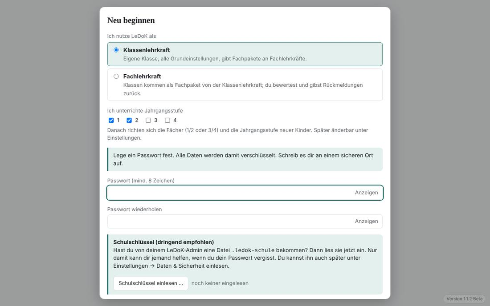{width="15.0cm"}

1.  **Rolle wählen:** *Klassenlehrkraft* (eigene Klasse, alle Grundeinstellungen) oder *Fachlehrkraft* (Klassen kommen als Fachpaket von der Klassenlehrkraft). Mehr dazu in Kapitel 4.
2.  **Jahrgangsstufen ankreuzen** (nur Klassenlehrkraft): 1, 2, 3 und/oder 4. Danach richten sich die eingeblendeten Fächer (Lehrplan 1/2 oder 3/4) und die Jahrgangsstufe neuer Kinder. Das kannst du später ändern.
3.  **Passwort festlegen:** mindestens 8 Zeichen, zweimal eingeben. Mit **Anzeigen** siehst du, was du tippst; bei eingeschalteter Feststelltaste erscheint ein Hinweis. Schreib das Passwort an einem sicheren Ort auf.
4.  **Schulschlüssel einlesen** (dringend empfohlen): Klicke auf **Schulschlüssel einlesen …** und wähle die Datei `.ledok-schule` deines LeDoK-Admins. Vergleiche den angezeigten Fingerabdruck mit dem Aushang des Admins. Nur mit Schulschlüssel kann dir jemand helfen, wenn du dein Passwort vergisst. Klickst du ohne Schulschlüssel auf **Starten**, fragt LeDoK einmal nach; ein zweiter Klick beginnt ohne.
5.  **Beispielklasse** (optional): Mit dem Häkchen „Mit Beispielklasse starten“ bekommst du eine ausgedachte Klasse zum Ausprobieren. Solange sie da ist, zeigt ein gelbes Band oben „Beispielklasse – nur zum Ausprobieren“. Mit **Beispiel entfernen und eigene Klasse anlegen** löschst du sie mit einem Klick. Trag in die Beispielklasse nie echte Kinder ein.
6.  **Starten** klicken. LeDoK verschlüsselt und öffnet sich.

### Jeden Tag: Öffnen, arbeiten, beenden

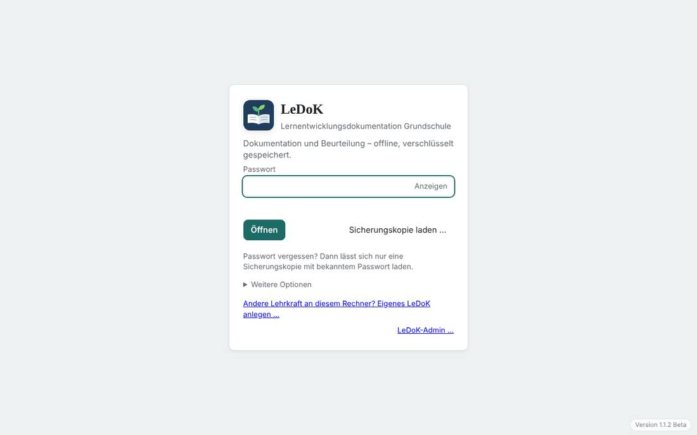{width="15.0cm"}

1.  **Öffnen:** LeDoK starten, Passwort eingeben, **Öffnen**. Teilen sich mehrere Lehrkräfte den Rechner, wählst du vorher bei **Wer arbeitet?** dich selbst aus.
2.  **Arbeiten:** LeDoK speichert nach jeder Eingabe automatisch und verschlüsselt. Oben siehst du „✓ gespeichert · Uhrzeit“.
3.  **Beenden:** Oben rechts auf **Beenden** klicken. LeDoK speichert, legt eine Sicherungskopie an und sperrt sich. In der Desktop-App landet die Kopie still im Ordner `Dokumente/LeDoK-Sicherungen`, im Browser einmal am Tag im Download-Ordner.

Nach **15 Minuten ohne Eingabe** sperrt sich LeDoK selbst. Ein angefangener Text (Notiz, Bericht, LEG) geht dabei nicht verloren. Sofort sperren kannst du über das Menü **☰ → Sperren**.

### Mehrere Lehrkräfte an einem Rechner

Jede Lehrkraft bekommt ein eigenes, getrennt verschlüsseltes LeDoK mit eigenem Passwort. So legst du es an:

1.  Auf dem Startbildschirm unten auf **Andere Lehrkraft an diesem Rechner? Eigenes LeDoK anlegen …** klicken.
2.  Im Dialog zusätzlich **Dein Name** eintragen, z. B. „Frau Huber“. Der Name erscheint nur in der Auswahl „Wer arbeitet?“.
3.  Weiter wie oben beim Einrichten.

Danach steht auf dem Startbildschirm die Auswahl **Wer arbeitet?**. Kein LeDoK kann die Daten eines anderen öffnen.

### Kurz erklärt: die Kopfzeile

| Element                                                                    | Bedeutung                                                                                                            |
|------------------------------------|------------------------------------|
| **KL** / **FL**                                                            | deine Rolle: Klassenlehrkraft oder Fachlehrkraft                                                                     |
| Reiter Heute, Erfassen, Übersicht, Kind, Sammelexport, Listen, Klassenbuch | die sieben Arbeitsbereiche (Kapitel 5). Auf kleineren Bildschirmen stehen sie in einer eigenen Zeile unter dem Logo. |
| Schalter **Kürzel ⇄ Namen**                                                | zeigt Kinder als S01, S02 … oder als „Anna M.“. Im Klassenzimmer auf Kürzel lassen.                                  |
| „✓ gespeichert“                                                            | Speicherstatus. Ein roter Knopf „Nicht gespeichert“ bedeutet: sofort eine Kopie herunterladen.                       |
| „Kopie: nie“ / „Kopie vor n Tagen“                                         | erscheint, wenn die letzte Sicherungskopie fehlt oder älter als 7 Tage ist                                           |
| **☰**                                                                      | Halbjahr umstellen, Darstellung Hell/Dunkel/Auto, Hilfe, Sperren                                                     |
| **?**                                                                      | Hilfe (auch mit der Taste ?)                                                                                         |
| **⚙ Einstellungen**                                                        | Klasse, Stundenplan, Fachlehrkräfte, Schuljahr, Fächer & Raster, Textbausteine, Dokumente, Daten & Sicherheit        |
| **Beenden**                                                                | speichern, sichern, sperren                                                                                          |
| „Version … Beta“ unten rechts                                              | Versionsdialog mit Update und „Problem melden“ (Kapitel 9)                                                           |

**Schnellsuche.** Mit **Strg+K** (Mac: **⌘K**) oder dem Knopf **⌕** oben öffnest du ein Suchfeld. Es findet Kinder, Themen der Beobachtung, Bereiche, Einstellungen und drei Aktionen (Sicherungskopie herunterladen, Bedienungsanleitung (Word) herunterladen, Jetzt sperren). Mit ↑ ↓ wählst du einen Treffer aus, Enter springt hin, Esc schließt. Im Kürzel-Modus sucht LeDoK nur nach Kürzeln, nicht nach Namen.

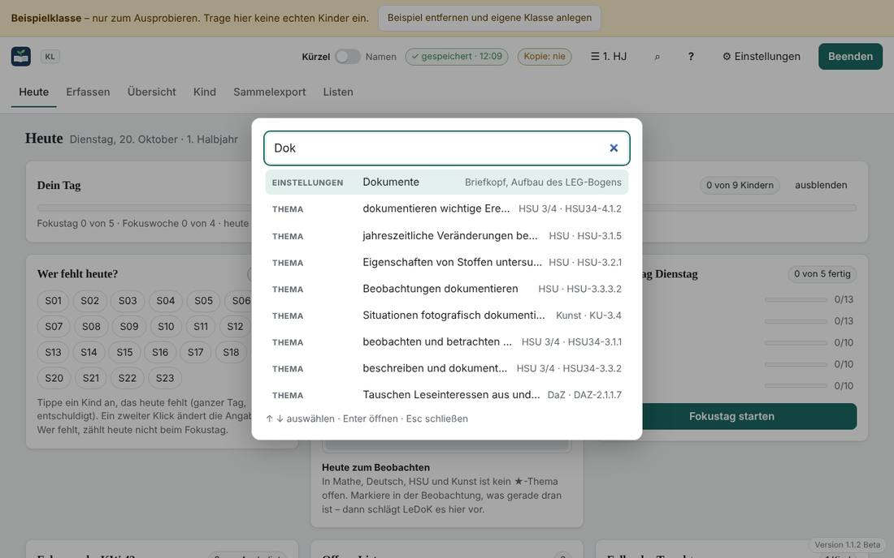{width="15.0cm"}

## 4 · Rollen

LeDoK kennt drei Rollen. Klassenlehrkraft und Fachlehrkraft wählst du beim Einrichten; die Rolle steht danach als **KL** oder **FL** oben links. Der LeDoK-Admin braucht keine eigene Klasse.

| Rolle                     | Wer?                                                                      | Was sie tut                                                                                                                             | Was sie nicht sieht                                                                                                         |
|------------------|------------------|------------------|------------------|
| **Klassenlehrkraft** (KL) | führt die Klasse                                                          | richtet alles ein: Kinder, Fächer, Raster, Textbausteine; legt Fachlehrkräfte an, gibt Fachpakete weiter und liest Rückmeldungen ein    | –                                                                                                                           |
| **Fachlehrkraft** (FL)    | unterrichtet einzelne Fächer in fremden Klassen                           | übernimmt Fachpakete, bewertet wie gewohnt, gibt Rückmeldungen zurück                                                                   | volle Nachnamen, Geburtsdaten, Notizen und Bewertungen anderer Fächer                                                       |
| **der LeDoK-Admin**       | eine Vertrauensperson der Schule, z. B. Schulleitung oder Systembetreuung | erstellt einmal den Schulschlüssel, stellt bei vergessenem Passwort den Zugang wieder her, schaltet den Hersteller-Support ein oder aus | im Alltag nichts; er kommt nur mit dem Masterkennwort an Daten, und jede Wiederherstellung steht im Protokoll der Lehrkraft |

**Fachlehrkraft:** Nach dem Einrichten zeigt dir LeDoK eine Willkommensseite. Du musst nichts selbst einrichten: Kinderliste, Raster und Einstellungen kommen mit dem Fachpaket. In den Einstellungen siehst du nur **Fachpakete** und **Daten & Sicherheit**.

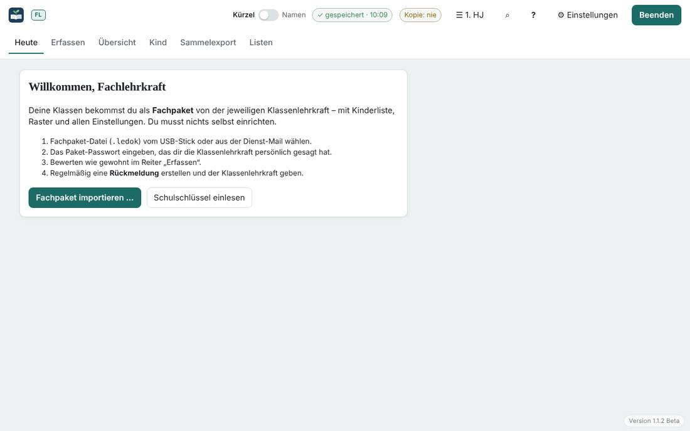{width="15.0cm"}

**LeDoK-Admin:** Den Bereich erreichst du auf dem Startbildschirm über den Link **LeDoK-Admin …** unten rechts, ohne Anmeldung. Was dort zu tun ist, steht in Kapitel 8.

**Wie die Zusammenarbeit läuft**, steht in Kapitel 6: Die Klassenlehrkraft gibt ein Fachpaket per USB-Stick oder Dienst-Mail weiter, die Fachlehrkraft bewertet und gibt eine Rückmeldung zurück. Arbeiten beide am selben Rechner mit je eigenem LeDoK, geht die Rückmeldung auch ohne Stick.

## 5 · Die Arbeitsbereiche

### 5.1 Die Skala 1 bis 9

Jede Bewertung ist eine Zahl von 1 bis 9. Die Farben auf den Knöpfen helfen beim schnellen Einordnen.

| Wert | Bedeutung                  | Farbe |
|------|----------------------------|-------|
| 1–2  | noch nicht                 | rot   |
| 3–4  | mit Hilfe                  | rot   |
| 5–6  | teilweise sicher           | gelb  |
| 7–8  | sicher, Erwartung erreicht | grün  |
| 9    | sicher und übertragend     | blau  |

-   **Erwartung (Soll):** voreingestellt 5 für Jahrgangsstufe 1 und 7 für Jahrgangsstufe 2. Je Kompetenz und je Jahrgangsstufe änderbar im Raster.
-   **Stand** = Mittel der letzten drei Werte. Übergeordnete Bereiche (Σ) und Fächer werden aus ihren Unterbereichen berechnet.
-   **Trend** im Schuljahr: ↑ ab +2, ↓ ab −2, sonst →.
-   **Farben in Tabellen:** grün = Soll erreicht, gelb = bis 1,5 darunter, rot = deutlich darunter.
-   **Lernniveau ↑:** Ein Kind kann in einzelnen Fächern an der nächsthöheren Jahrgangsstufe gemessen werden. Das stellst du in der Klassenliste ein (5.9). Es erscheint als Abzeichen „↑J3“.

### 5.2 Heute

Heute ist deine Startseite. Oben stehen, wenn nötig, der Hinweis zur Sicherung und der Balken Dein Tag. Darunter ordnet LeDoK die Karten in drei Bereiche: Jetzt im Unterricht, Lernstand im Blick und Organisation. Mit einem Klick auf die Überschrift klappst du einen Bereich zu oder wieder auf; LeDoK merkt sich das. Karten ohne Inhalt, zum Beispiel Offene Listen ohne offene Liste, erscheinen nicht. Karten, die du nie brauchst, blendest du unter Einstellungen → Ansicht ganz aus (Kapitel 5.9).

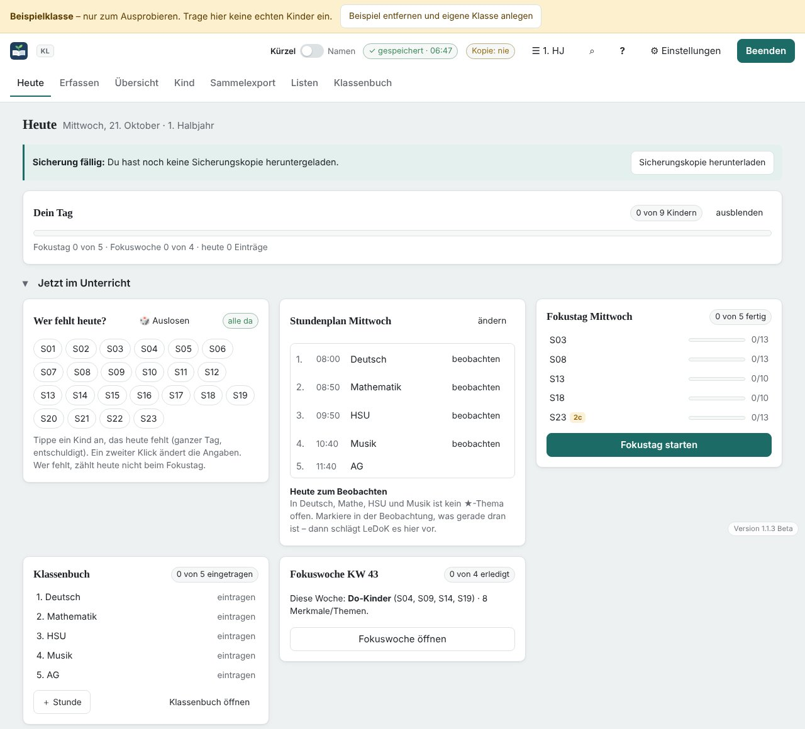{width="15.0cm"}

-   **Dein Tag:** Der Balken ganz oben zeigt, wie viele Kinder von Fokustag und Fokuswoche du heute schon erfasst hast, zum Beispiel „3 von 9 Kindern“. Ein Kind des Fokustags zählt, sobald alle seine Fokus-Themen bewertet sind. Ist alles geschafft, wird der Balken grün. Mit **ausblenden** schaltest du ihn ab; oben rechts holst du ihn mit **Tagesfortschritt einblenden** zurück. Kinder, die heute fehlen, zählen nicht mit. An Wochenenden, an schulfreien Tagen (Ferien, Feiertage) und für Fachlehrkräfte erscheint er nicht.
-   **Sicherung:** Ist eine Sicherungskopie fällig (noch keine oder älter als eine Woche), steht ganz oben ein Hinweis mit dem Knopf Sicherungskopie herunterladen. Sonst zeigt nur die Kopfzeile unter „Kopie“, wann du zuletzt gesichert hast.

**Jetzt im Unterricht**

-   Als Klassenlehrkraft siehst du oben außerdem eine Karte **Fachlehrkräfte** mit dem Stand der Rückmeldungen; als Fachlehrkraft eine Karte **Rückmeldungen**.
-   **Wer fehlt heute?** Tippe ein Kind an, das heute fehlt; ein zweiter Klick ändert die Angaben (Kapitel 5.7, Fehltage). 🎲 Auslosen zieht ein Kind in der Großanzeige (Kapitel 5.7, Auslosen).
-   **Stundenplan:** die Stunden des Tages, die laufende hervorgehoben. **beobachten** öffnet das Fach direkt in der Beobachtung. Darunter schlägt LeDoK bis zu zwei ★-Themen dieser Fächer vor, die du in den letzten 14 Tagen wenig beobachtet hast. **ändern** führt zu Einstellungen → Stundenplan. Die Karte erscheint, sobald ein Stundenplan eingetragen ist.
-   **Fokustag:** Kinder des heutigen Wochentags und wie viele Fokus-Themen bei jedem schon bewertet sind. **Fokustag starten** springt direkt ins Erfassen.
-   **Klassenbuch:** die Stunden des Tages mit dem Stand des Klassenbuchs. Ein Klick öffnet den Eintrag, **＋ Stunde** trägt eine weitere Stunde ein, **Klassenbuch öffnen** führt zur Woche (Kapitel 5.8).
-   **Fokuswoche:** welche Wochentagsgruppe diese Woche im Arbeits- und Sozialverhalten dran ist.

**Lernstand im Blick**

-   **Größte Schwierigkeiten:** Kinder, die bei aktuellen Themen mehr als 1 Punkt unter der Erwartung liegen. Zuerst stehen die vier Kinder mit dem größten Abstand, mehr anzeigen zeigt bis zu acht. Wie wird das berechnet? klappt die Erklärung auf, ebenso bei Fallender Trend.
-   **Fallender Trend:** Kinder, deren Stand in einem Fach im Schuljahr deutlich gesunken ist.
-   **Wenig beobachtet:** Kinder mit wenigen Einträgen in den letzten 4 Wochen.
-   **Aktuelle Themen (★):** was gerade im Unterricht dran ist und wie viele Kinder du dazu in den letzten 14 Tagen bewertet hast.

**Organisation**

-   **Ferien:** wie viele Schultage es noch bis zu den nächsten Ferien sind, dazu Feiertage und unterrichtsfreie Tage im nächsten Monat, zum Beispiel der Buß- und Bettag. In den Ferien und an Feiertagen steht dort „Heute ist schulfrei“ mit dem nächsten Schultag. **Kalender** öffnet Einstellungen → Ferien & Feiertage (Kapitel 5.9).
-   **Dienste:** wer in dieser Runde Tafeldienst, Austeildienst usw. hat. Fehlt ein Kind, steht daneben eine Vertretung. **Plan** öffnet Listen → Dienste (Kapitel 5.7).
-   **Offene Listen:** Sammellisten, bei denen noch Geld, ein Zettel oder eine Unterschrift fehlt. Ein Klick öffnet die Liste.
-   **Klassenrat:** erscheint, wenn heute eine Sitzung läuft, Anliegen im Briefkasten liegen oder ein Beschluss fällig ist. Ein Klick öffnet Sitzung oder Briefkasten (Kapitel 5.7, Klassenrat).

An schulfreien Tagen, also in den Ferien, an Feiertagen, am Buß- und Bettag und an freien Tagen deiner Schule, blendet Heute die Karten **Wer fehlt heute?**, **Stundenplan**, **Dienste** und **Klassenbuch** aus. Die Karte **Fokustag** nennt dann den nächsten Schultag und die Kinder, die dort dran sind.

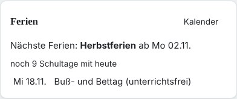{width="7.5cm"}

### 5.3 Erfassen

Im Reiter **Erfassen** bewertest du, im Unterricht oder danach. Oben wählst du einen von fünf Modi und rechts das Datum.

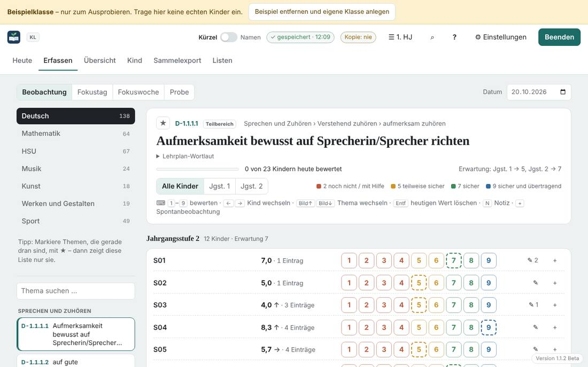{width="15.0cm"}

**Beobachtung.** Links Fach und Thema wählen, rechts jedem Kind einen Wert geben. Pro Kind, Thema und Tag gibt es einen Wert; ein zweiter Klick auf denselben Wert nimmt ihn zurück. Der gestrichelte Rahmen zeigt den letzten Wert. Über die Suche findest du jedes Thema, und mit ★ markierst du aktuelle Unterrichtsthemen; die Liste zeigt dann auf Wunsch nur diese.

**Fokustag.** Jedes Kind hat einen festen Wochentag (Montag bis Freitag) und wird an diesem Tag in allen Themen bewertet, die im Raster auf „Fokustag“ stehen. Du kannst nach Thema (ein Thema, alle Kinder) oder nach Kind (ein Kind, alle Themen) arbeiten.

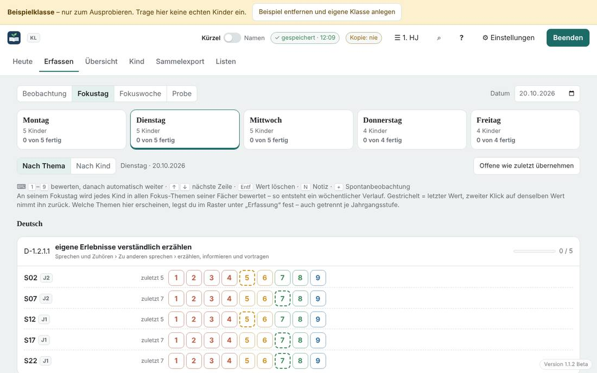{width="15.0cm"}

**Fokuswoche.** Wie der Fokustag, aber jede Wochentagsgruppe ist nur alle fünf Wochen dran. Ein Wert gilt für die ganze Woche. Voreingestellt für das Arbeits- und Sozialverhalten (ASV).

**Probe.** 1. Fach wählen, 2. Kompetenzen wählen, 3. Punkte oder Prozent je Kind eintragen. LeDoK rechnet linear um: 0 % = 1, 50 % = 5, 100 % = 9. Fehlende Kinder markierst du als „fehlt“.

**Lern-App.** Hier überträgst du Ergebnisse aus einer Lern-App wie ANTON, die die Kinder in der Schule nutzen. Trage oben den Namen der App ein (LeDoK merkt ihn sich) und auf Wunsch die Übung. Dann gibst du je Kind entweder den Prozentwert ein, den die App zeigt, und drückst Enter, oder du klickst gleich einen Wert von 1 bis 9. LeDoK rechnet Prozent wie bei der Probe um und springt zum nächsten Kind. Hier stehen alle Themen des Fachs, auch solche, die sonst am Fokustag dran sind.

Die Werte zählen wie Beobachtungen. In den Einträgen des Kindes, im Verlauf und im CSV-Export steht als Quelle „Lern-App“, in der Notiz App, Übung und Prozent. Eine Beobachtung am selben Tag zum selben Thema bleibt davon getrennt. LeDoK verbindet sich nicht mit der App: Es gelangt nur hinein, was du selbst einträgst. Ergebnisse aus einer App zeigen den Übungsstand und ersetzen nicht deine eigene Beobachtung.

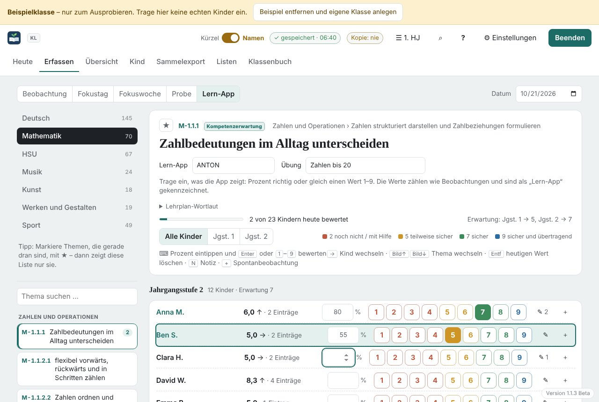{width="15.0cm"}

**Weitere Werkzeuge beim Erfassen**

-   **＋ Spontanbeobachtung:** Thema suchen, Wert und Notiz eintragen, ohne den Modus zu wechseln. Auch über das ＋ an jeder Kind-Zeile.
-   **✎ Notiz:** freie Notiz zum Kind, mit Klick-Bausteinen. Strg + Enter speichert.
-   **Worauf achten:** Ist ein Oberbereich im Raster als Bewertungsebene markiert (◎ Hier bewerten, auch pauschal für ein ganzes Fach), bewertest du ihn als Ganzes. Seine Unterbereiche erscheinen dann nur noch als Hinweis „Worauf achten“.
-   **Kürzel von Fachlehrkräften:** Werte, in denen Bewertungen einer Fachlehrkraft stecken, tragen ein kleines Kürzel mit ihrem Namen.

**Tastenkürzel im Reiter Erfassen**

| Taste       | Beobachtung           | Fokustag / Fokuswoche |
|-------------|-----------------------|-----------------------|
| 1 bis 9     | bewerten              | bewerten, dann weiter |
| ← →         | Kind wechseln         | –                     |
| ↑ ↓         | –                     | Zeile wechseln        |
| Bild↑ Bild↓ | Thema wechseln        | –                     |
| Entf        | heutigen Wert löschen | heutigen Wert löschen |
| N           | Notiz zum Kind        | Notiz zum Kind        |
| \+          | Spontanbeobachtung    | Spontanbeobachtung    |
| Esc         | Auswahl aufheben      | Auswahl aufheben      |

Überall öffnet die Taste **?** die Hilfe.

### 5.4 Übersicht

Die **Übersicht** zeigt die ganze Klasse × Fächer mit Stand und Trend.

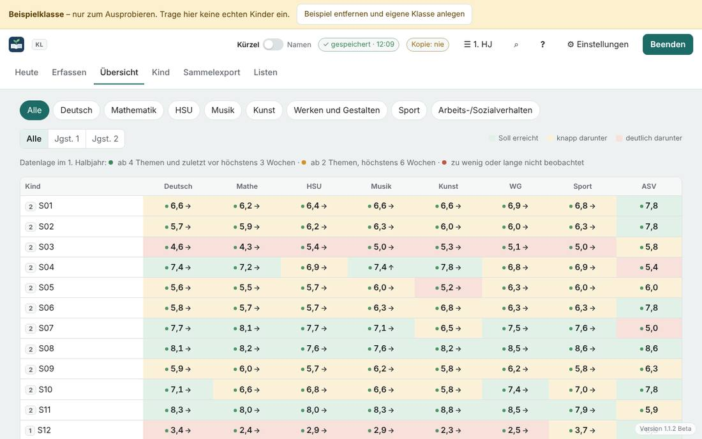{width="15.0cm"}

-   Oben wählst du **Alle** Fächer, ein einzelnes Fach oder das **Arbeits-/Sozialverhalten**, darunter die Jahrgangsstufe.
-   Bei einem einzelnen Fach schaltest du zwischen **Lernbereichen** und **Kompetenzen** um; dazu kommt die Spalte Ø Fach mit dem Notenvorschlag ab Jahrgangsstufe 2.
-   Der farbige Punkt vor jedem Wert ist die **Datenlage**: grün = ab 4 Themen und zuletzt vor höchstens 3 Wochen bewertet, gelb = ab 2 Themen und höchstens 6 Wochen, rot = zu wenig oder lange nicht beobachtet.
-   Werte erscheinen ab dem ersten Eintrag. Beruht eine Zelle auf weniger als drei Einträgen, gilt sie als erste Tendenz.
-   Ein Klick auf eine Zelle öffnet das Kind bzw. zeigt alle Einträge.

### 5.5 Kind

Im Reiter **Kind** siehst du alles zu einem Kind. Mit ‹ und › oder der Auswahlliste wechselst du das Kind.

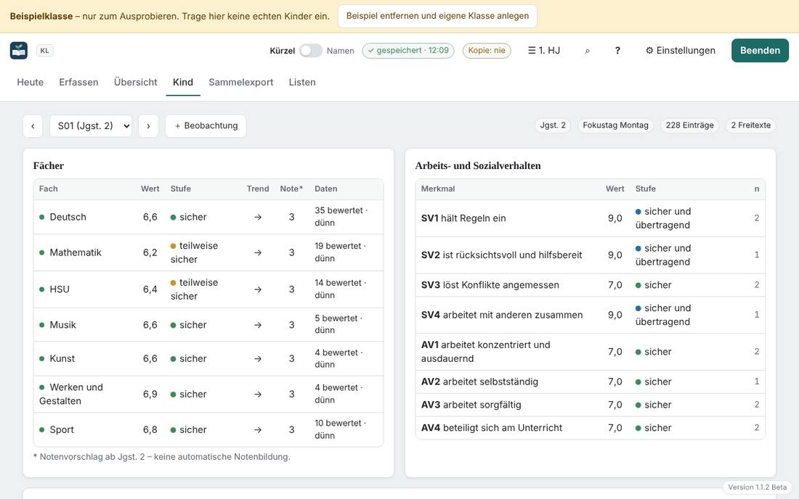{width="15.0cm"}

-   **Fächer:** Wert, Stufe, Trend, Notenvorschlag (ab Jahrgangsstufe 2) und Datenlage je Fach.
-   **Arbeits- und Sozialverhalten:** die acht Merkmale SV1–SV4 und AV1–AV4.
-   **Kompetenzen im Detail:** der ganze Kompetenzbaum des Kindes mit allen Werten, aufgeklappt bis zur Bewertungsebene. Siehe unten.
-   **Themen nur beim Kind:** Themen, die im Raster auf „nur beim Kind“ stehen, bewertest du hier.
-   **Lernverlauf:** Diagramme je Fach oder je Thema, auch zum Drucken.
-   **Freitext-Journal:** Notizen nach Kategorien, verschlüsselt gespeichert.
-   **Übergabe** (nur Klassenlehrkraft): ein einzelnes Kind als verschlüsselte Datei an eine andere Klasse weitergeben, z. B. bei einem Klassenwechsel.
-   **Bericht / Zeugnistext:** ein Entwurf aus den Textbausteinen. Du überarbeitest ihn direkt im Feld; LeDoK speichert beim Tippen. **Neu erzeugen** verwirft deine Überarbeitung.
-   **LEG-Bogen:** Stärken, Übungsfelder, Fachstand, Ziele und Vereinbarung prüfen und anpassen. Beim Drucken fragt LeDoK Nachname und Geburtsdatum für den Kopf ab; du entscheidest, ob sie verschlüsselt gespeichert werden.
-   **Förderplan:** Ausgangslage, Ziele, Maßnahmen und Stand der Überprüfung für ein Kind, siehe unten.

**Kompetenzen im Detail.** Die Tabelle zeigt für jedes Fach die Lernbereiche (**LB**), Kompetenzen (**K**), Kompetenzerwartungen (**KE**) und Teilbereiche (**TB**). Oberbereiche tragen ein Σ: Ihr Wert ist aus den Unterbereichen berechnet. Mit ◎ sind die Bereiche markiert, die du als Ganzes bewertest.

**Überblick bis**: Mit den Knöpfen über der Tabelle legst du fest, wie weit der Baum aufgeklappt ist. **Bewertungsebene** (Voreinstellung) klappt jedes Fach so weit auf, wie du es unter **Einstellungen → Fächer & Raster** bei „Bewertungsebene in …“ eingestellt hast; ist ein Lernbereich feiner eingestellt, geht es dort tiefer. **LB**, **K** und **KE** zeigen alle Fächer bis zu dieser Ebene, **alles** klappt alles auf. Für einen schnellen Überblick wählst du zum Beispiel **LB**: Du siehst je Fach nur die Lernbereiche mit den zusammengefassten Werten.

**Einzelne Bereiche** klappst du mit ▸ und ▾ vor der Zeile auf und zu. **wie gewählt** stellt wieder die gewählte Ebene für alle Bereiche her.

**Zeilen zeigen**: Mit den Knöpfen **Lernbereiche**, **Kompetenzen**, **Kompetenzerwartungen** und **Teilbereiche** blendest du alle Zeilen einer Ebene aus und wieder ein. Blendest du zum Beispiel Lernbereiche und Kompetenzen aus und wählst **KE**, stehen nur noch die Kompetenzerwartungen untereinander. Eine Ebene bleibt immer sichtbar. LeDoK merkt sich deine Auswahl, auch für die anderen Kinder.

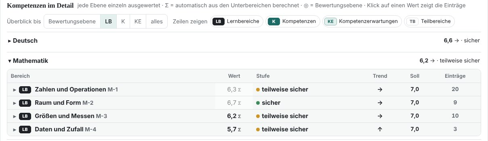{width="15.0cm"}

**Förderplan.** Unter **Kind → Förderplan** legst du mit **Förderplan anlegen** einen Plan an. Er enthält Zeitraum, Beteiligte (z. B. Klassenleitung, Förderlehrkraft, Eltern), die Ausgangslage und beliebig viele Ziele. Jedes Ziel hat Maßnahmen, Zuständige („Wer“), einen Termin („bis“) und einen Stand: offen, teilweise erreicht oder erreicht. LeDoK speichert beim Tippen.

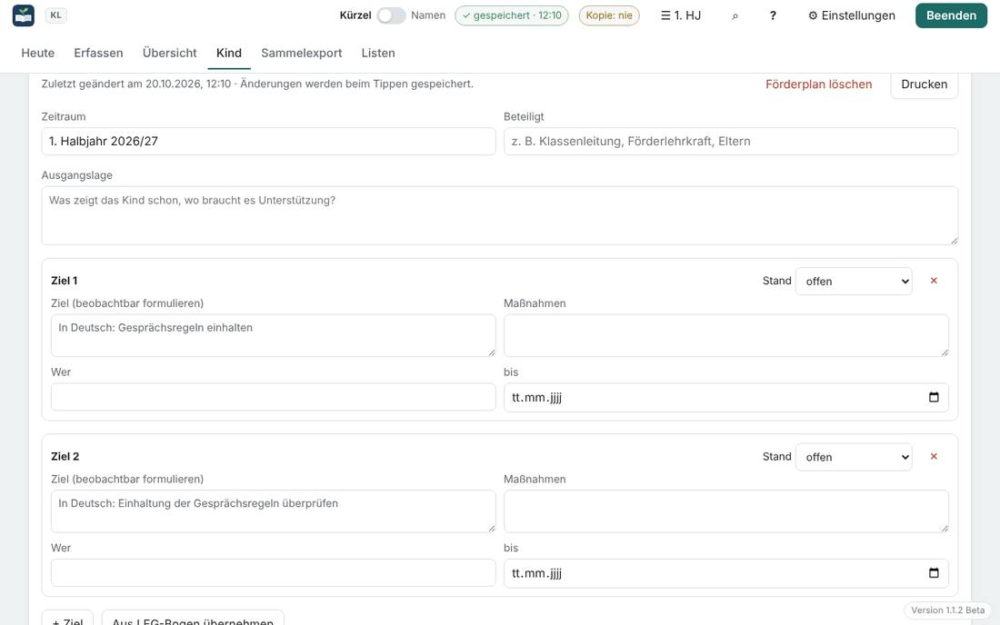{width="15.0cm"}

-   **+ Ziel** fügt ein weiteres Ziel hinzu, ✕ entfernt eines.
-   **Aus LEG-Bogen übernehmen** schreibt die Übungsfelder in die Ausgangslage und übernimmt die Ziele des LEG-Bogens, ohne doppelte Einträge.
-   **Drucken** druckt den Plan mit Briefkopf (wie beim Bericht) und mit Vor- und Nachnamen des Kindes. Darunter siehst du eine Vorschau.
-   **Förderplan löschen** entfernt den Plan nach einer Rückfrage. Wird ein Kind gelöscht, verschwindet auch sein Förderplan. In die Übergabedatei für ein einzelnes Kind kommt der Förderplan nicht mit.

### 5.6 Sammelexport

Der **Sammelexport** erzeugt Druckseiten für alle Kinder auf einmal. Vor jedem Druck zeigt LeDoK eine Druckvorschau der Seiten; erst „Drucken …“ öffnet den Druckdialog. Dort wählst du „Als PDF speichern“, wenn du Dateien brauchst.

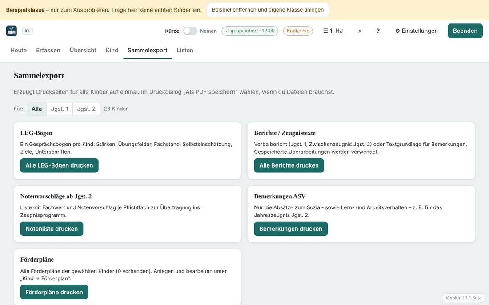{width="15.0cm"}

-   **LEG-Bögen** für alle Kinder.
-   **Berichte / Zeugnistexte** (Verbalbericht Jahrgangsstufe 1, Zwischenzeugnis Jahrgangsstufe 2). Gespeicherte Überarbeitungen werden verwendet.
-   **Notenvorschläge ab Jahrgangsstufe 2** mit Fachwert, zur Übertragung ins Zeugnisprogramm. Notenvorschläge sind eine Orientierung, keine automatische Notenbildung.
-   **Bemerkungen ASV:** nur die Absätze zum Sozial- sowie Lern- und Arbeitsverhalten.
-   **Notengrenzen:** ab welchem Fachwert welche Note vorgeschlagen wird. Bitte im Kollegium abstimmen.
-   **Fördergruppen:** Kinder unter bzw. über der Erwartung, zum Drucken.
-   **Förderpläne:** alle Förderpläne der gewählten Kinder auf einmal (nur Klassenlehrkraft).
-   **KI-Auswertung (anonymisiert):** erzeugt einen Text nur mit Kürzeln; bekannte Namen werden geschwärzt. Du musst den Text vollständig lesen und bestätigen, bevor du ihn kopieren oder herunterladen kannst. Nutze nur eine KI, die deine Schule freigegeben hat, und lösche die Datei danach.

**LEG-Planer.** Hier planst du die Lernentwicklungsgespräche des aktuellen Halbjahres. Die Tabelle zeigt je Kind Datum, Uhrzeit und „geführt“, gefiltert nach der oben gewählten Jahrgangsstufe. Uhrzeit und Haken lassen sich erst setzen, wenn ein Datum eingetragen ist. Löschst du das Datum, ist der Termin entfernt. Die Termine gelten je Halbjahr, und das Datum erscheint auf dem LEG-Bogen bei „Gespräch am …“.

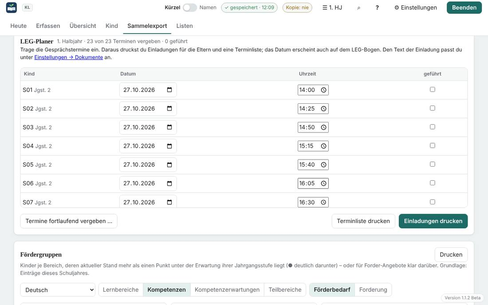{width="15.0cm"}

-   **Termine fortlaufend vergeben …:** Du wählst den ersten Tag, Beginn, Minuten je Gespräch (vorgegeben 20) und Pause dazwischen (vorgegeben 5). LeDoK vergibt die Termine in der Reihenfolge der Liste, auf Wunsch nur für Kinder ohne Termin. Unter dem Formular siehst du vorab, wie viele Termine es werden, auf wie viele Tage sie sich verteilen und wann der letzte ist.
-   **Termine pro Tag:** Mit Höchstens Termine pro Tag (vorgegeben 8) und Letztes Gespräch endet spätestens (vorgegeben 18:00 Uhr) begrenzt du einen Gesprächstag. Ist der Tag voll, plant LeDoK am nächsten Schultag weiter, wieder ab der Beginn-Uhrzeit; Wochenenden, Ferien, Feiertage und die freien Tage deiner Schule überspringt es. Bei 28 Kindern, 20 Minuten je Gespräch und 5 Minuten Pause werden es so zum Beispiel vier Nachmittage statt eines Abends bis nach 22 Uhr. Lässt du ein Feld leer, gilt dafür keine Grenze. LeDoK merkt sich deine Angaben für das nächste Mal.
-   **Schulfreie Tage:** Liegt ein Termin in den Ferien, an einem Feiertag oder am Wochenende, steht neben dem Datum ⚠ mit dem Grund, zum Beispiel „Buß- und Bettag“. Beim fortlaufenden Vergeben schlägt LeDoK den ersten Schultag in einer Woche vor und warnt, wenn der gewählte Tag schulfrei ist.
-   **Einladungen drucken:** ein Brief je Kind mit Termin, mit Briefkopf und auf Wunsch einem Abschnitt zum Zurückgeben. Hat kein Kind einen Termin, fragt LeDoK, ob es Einladungen mit leerer Terminzeile für alle drucken soll. Den Text passt du unter Einstellungen → Dokumente an.
-   **Terminliste drucken:** alle Kinder, sortiert nach Tag und Uhrzeit, mit Kästchen für „geführt“.

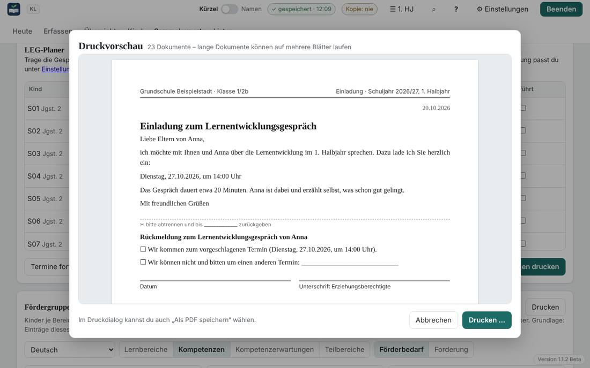{width="15.0cm"}

### 5.7 Listen

Im Reiter **Listen** behältst du alles im Blick, was du für die ganze Klasse einsammelst oder zählst. Oben rechts wechselst du zwischen **Sammellisten**, **Klassenkasse**, **Fehltage**, **Dienste**, **Auslosen** und **Klassenrat**.

**Sammellisten.** Links stehen deine Listen, die neueste oben, abgeschlossene grau.

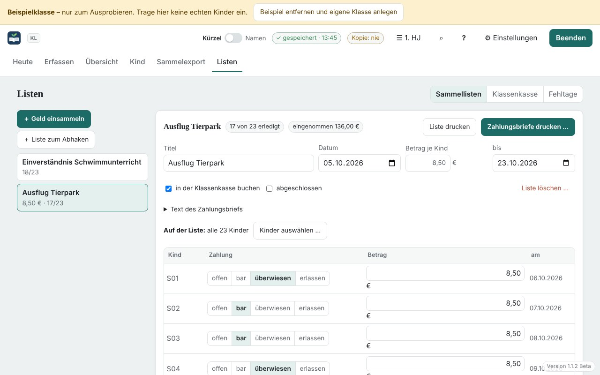{width="15.0cm"}

-   **＋ Geld einsammeln** fragt nach dem Zweck (z. B. „Ausflug Tierpark“) und dem Betrag je Kind. Je Kind klickst du **bar**, **überwiesen** oder **erlassen**; **offen** nimmt die Angabe zurück. Bei bar und überwiesen kannst du den Betrag für ein einzelnes Kind ändern, etwa bei Geschwisterrabatt. Oben siehst du, wie viele Kinder erledigt sind und wie viel eingenommen ist.

-   **＋ Liste zum Abhaken** ist für Rückmeldezettel, Einverständnisse oder Unterschriften: je Kind ein Haken „erledigt“ mit Datum. Trägst du einen Betrag ein, wird daraus eine Geldliste.

-   Titel, Datum, Betrag je Kind und Frist („bis“) änderst du direkt in der Liste. **in der Klassenkasse buchen** (bei Geldlisten eingeschaltet) übernimmt die Einnahmen ins Kassenbuch. **abgeschlossen** legt eine fertige Liste ab, **Liste löschen …** entfernt sie.

-   **Kinder auswählen …** legt fest, wer auf der Liste steht. Neue Listen gelten für alle Kinder; über der Tabelle steht, wie viele es sind. Im Fenster grenzt du die Anzeige mit drei Filtern ein: **Name** (bzw. Kürzel, solange oben „Kürzel“ eingestellt ist), **Klasse** (deine eigene Klasse und z. B. 1a, 1b oder 2c bei Kindern aus anderen Klassen) und **Jahrgangsstufe**. Mit **Angezeigte auswählen** und **Angezeigte abwählen** setzt oder entfernst du die Haken aller angezeigten Kinder auf einmal, einzelne Kinder hakst du direkt an. Die Filter verändern nur die Anzeige; was angehakt ist, kommt mit **Übernehmen** auf die Liste. Beispiel: Für einen Ausflug nur der 1. Jahrgangsstufe klickst du ohne Filter auf „Angezeigte abwählen“, wählst dann Jahrgangsstufe 1 und klickst „Angezeigte auswählen“.

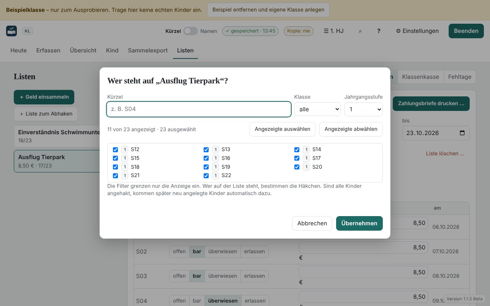{width="15.0cm"}

-   Sind alle Kinder angehakt, kommen später neu angelegte Kinder automatisch auf die Liste. Wählst du ein Kind ab, bei dem schon etwas eingetragen ist, fragt LeDoK nach; die Zahlung wird dann gelöscht und fällt aus der Summe und dem Kassenbuch. Liste drucken, Zahlungsbriefe und „Offene Listen“ auf Heute berücksichtigen nur die Kinder der Liste.

-   **Liste drucken** druckt die Liste zum Abheften.

-   **Zahlungsbriefe drucken …** öffnet ein Fenster mit zwei Fragen. **Welches Dokument?** **personalisiert** erzeugt für jedes Kind, das noch offen ist, einen eigenen Elternbrief mit Namen. **allgemein** erzeugt einen einzigen Brief ohne Namen, den du kopierst und an alle austeilst, zum Beispiel schon bevor du mit dem Einsammeln beginnst. Im allgemeinen Brief wird aus „Liebe Eltern von {Vorname},“ einfach „Liebe Eltern,“, andere Stellen mit {Vorname} heißen „Ihr Kind“. **Zahlungscode**: **mit GiroCode** druckt den QR-Code für die Banking-App dazu, **ohne Zahlungscode** nur die Überweisungsdaten. LeDoK merkt sich deine Wahl je Liste. Den Text änderst du unter **Text des Zahlungsbriefs** mit den Platzhaltern {Vorname}, {Zweck}, {Betrag}, {Frist}, {Lehrkraft}, {Klasse} und {Schule}; **Standardtext** stellt den mitgelieferten Text wieder her. Ist unter Klassenkasse eine gültige Bankverbindung eingetragen, stehen auf dem Brief die Überweisungsdaten und auf Wunsch ein **GiroCode**: Die Eltern scannen ihn mit ihrer Banking-App, Empfänger, Betrag und Verwendungszweck sind dann schon ausgefüllt. Beim allgemeinen Brief endet der Verwendungszweck mit „Kind:“, und die Eltern ergänzen den Namen ihres Kindes. Ohne Bankverbindung ist „mit GiroCode“ nicht wählbar, und der Brief bekommt einen Abschnitt zum Zurückgeben mit dem Bargeld (beim allgemeinen Brief mit einer Zeile für den Namen des Kindes).

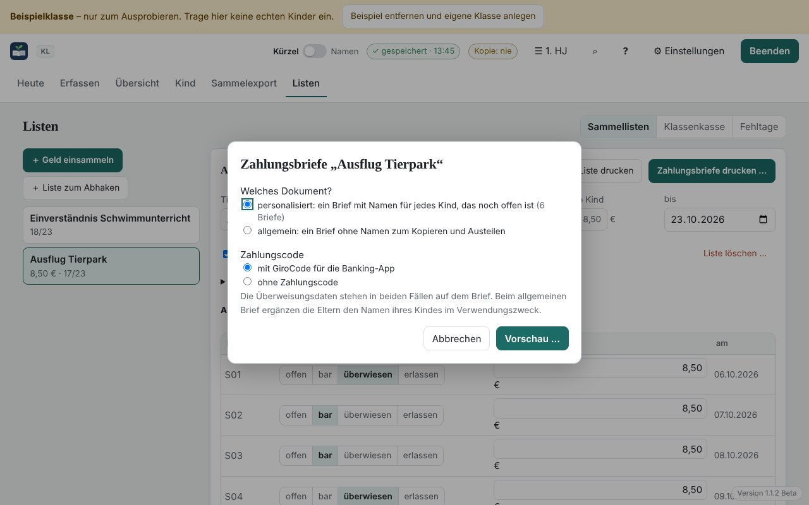{width="15.0cm"}

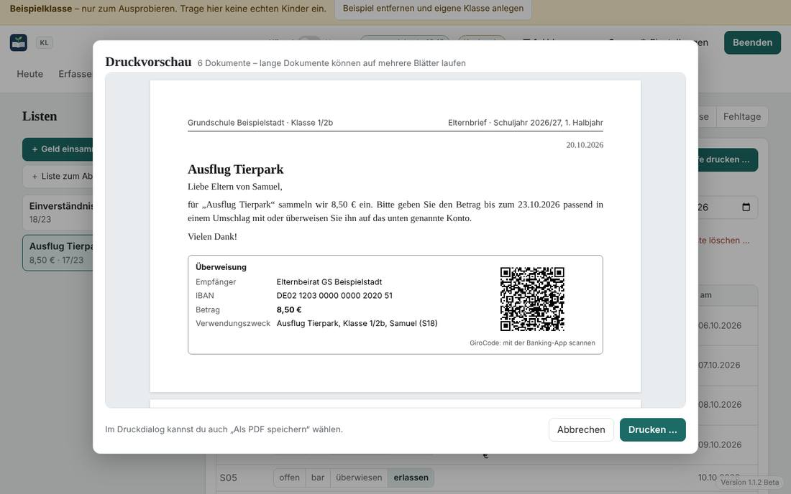{width="15.0cm"}

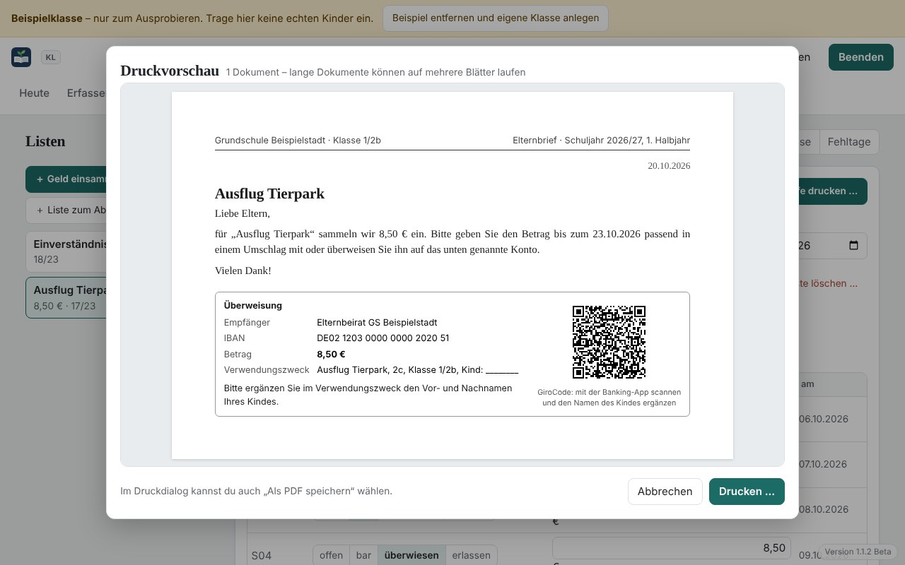{width="15.0cm"}

-   Verlässt ein Kind die Klasse, bleibt sein schon bezahltes Geld in der Summe der Liste und im Kassenbuch.

**Klassenkasse.** Hier führst du das Kassenbuch der Klasse.

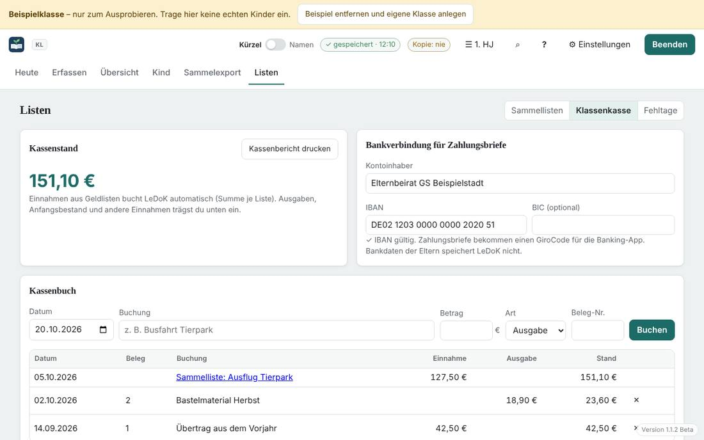{width="15.0cm"}

-   **Kassenstand** oben links. **Kassenbericht drucken** druckt das Kassenbuch, z. B. für den Elternbeirat.
-   **Bankverbindung für Zahlungsbriefe:** Kontoinhaber, IBAN und optional BIC des Klassenkontos. LeDoK prüft die IBAN sofort; nur mit gültiger IBAN druckt es einen GiroCode. Bankdaten der Eltern speichert LeDoK nicht.
-   **Kassenbuch:** Einnahmen aus Geldlisten bucht LeDoK selbst, eine Zeile je Liste. Ausgaben, den Anfangsbestand und andere Einnahmen trägst du mit Datum, Buchungstext, Betrag, Art (Ausgabe oder Einnahme) und Beleg-Nr. ein und klickst **Buchen**. Die Spalte „Stand“ zeigt den laufenden Kassenstand. Mit ✕ löschst du eine eigene Buchung.

**Fehltage.** Am schnellsten trägst du sie auf **Heute** unter **Wer fehlt heute?** ein: Kind antippen, dann gilt es als ganzer Tag entschuldigt. Ein zweiter Klick öffnet die Angaben: **ganzer Tag** oder **teilweise** mit Stundenzahl, **entschuldigt** ja oder nein und eine kurze Bemerkung. Trage dort keine Gesundheitsangaben ein; „krank“ genügt. **Doch anwesend** löscht den Eintrag wieder.

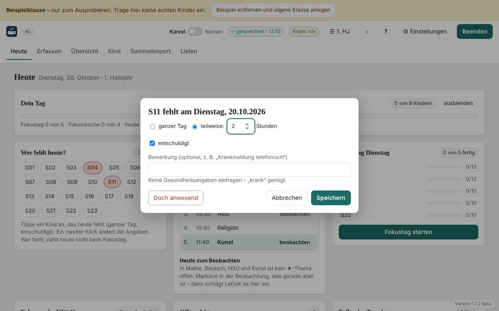{width="15.0cm"}

Unter **Listen → Fehltage** siehst du je Kind die ganzen Tage, davon unentschuldigte, und die teilweisen Fehltage mit Stunden, getrennt nach Halbjahr, z. B. für das Zeugnis. Mit **Fehltag eintragen …** trägst du einen Tag nach; ein Klick auf einen Tag ändert ihn. „½“ steht für teilweise, „u“ für unentschuldigt. **Liste drucken** druckt die Übersicht. Ein Fehltag zählt zu dem Halbjahr, das beim Eintragen eingestellt war.

Fehlt ein Kind mehrere Tage, gib zusätzlich **bis** an. LeDoK trägt dann nur die Schultage ein, ohne Wochenenden, Ferien und Feiertage, ganztägig und entschuldigt; einzelne Tage änderst du danach mit einem Klick. Liegt ein einzelnes Datum auf einem schulfreien Tag, fragt LeDoK vorher nach.

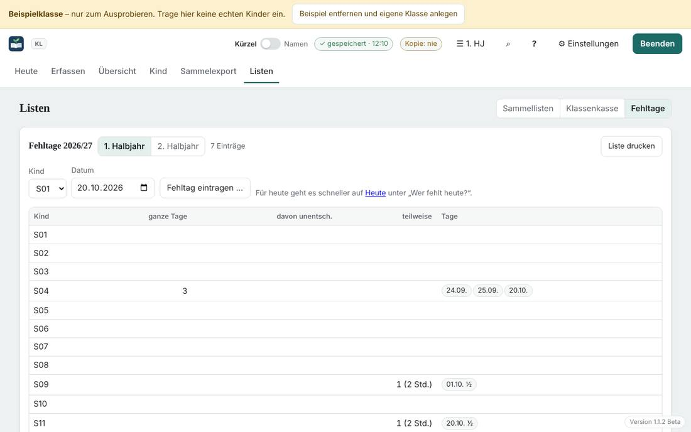{width="15.0cm"}

Wer heute fehlt, zählt beim Fokustag und im Balken „Dein Tag“ nicht mit. In Erfassen und auf der Kind-Seite ist das Kind als „fehlt“ markiert.

**Dienste.** Unter **Listen → Dienste** verteilst du die Klassendienste wie Tafeldienst, Austeildienst oder Blumendienst reihum an alle Kinder. LeDoK rechnet selbst aus, wer dran ist: Jede Runde kommen die nächsten Kinder der Reihe dran, und nach jedem Durchlauf der Klasse rücken die Dienste einen Platz weiter, damit jedes Kind mal jeden Dienst hat.

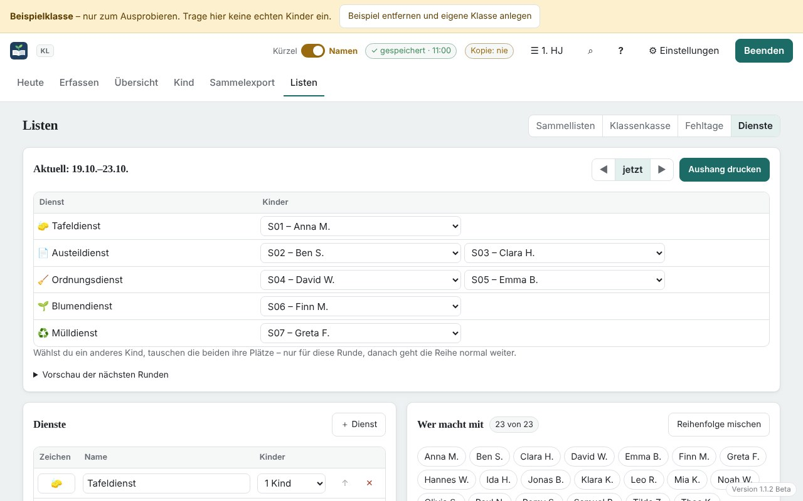{width="15.0cm"}

-   **Dienste anlegen:** Beim ersten Mal übernimmst du mit **Vorschläge übernehmen** sechs übliche Dienste. Mit **＋ Dienst** legst du weitere an, zum Beispiel „Lichtdienst“ oder „Klassentier füttern“. Je Dienst stellst du ein Zeichen (z. B. 🧽), den Namen und die Zahl der Kinder (1 bis 4) ein. Mit ↑ änderst du die Reihenfolge, mit ✕ löschst du einen Dienst.
-   **Wechsel:** jede Woche, alle zwei Wochen oder jeden Schultag. Am Wochenende und in den Ferien zeigt LeDoK schon die nächste Runde.
-   **Wer macht mit:** Alle Kinder der Klasse sind dabei, sortiert nach Kürzel. **Reihenfolge mischen** lost eine neue Reihenfolge aus, **nach Kürzel** stellt die alte wieder her. Tippst du ein Kind an, macht es gerade Pause (zum Beispiel bei einem gebrochenen Arm); ein zweiter Klick nimmt es wieder auf.
-   **Tauschen:** Oben siehst du die aktuelle Runde, mit ◀ und ▶ die davor und danach. Wählst du bei einem Dienst ein anderes Kind, tauschen die beiden ihre Plätze, nur für diese Runde. Hatte das gewählte Kind keinen Dienst, hat das bisherige diesmal frei. **Änderungen dieser Runde zurücknehmen** stellt den berechneten Plan wieder her.
-   **Ferien und Feiertage:** Mit **in Ferien und an Feiertagen pausieren** (so ist es eingestellt) zählen nur Wochen mit Unterricht, beim Wechsel „jeden Schultag“ nur Schultage. Nach den Ferien machen die Kinder weiter, die als Nächstes dran wären, und niemand verliert seinen Dienst. Ohne den Haken läuft der Plan mit dem Kalender weiter. Mit **eine Runde zurück** oder **eine Runde weiter** verschiebst du ihn von Hand.

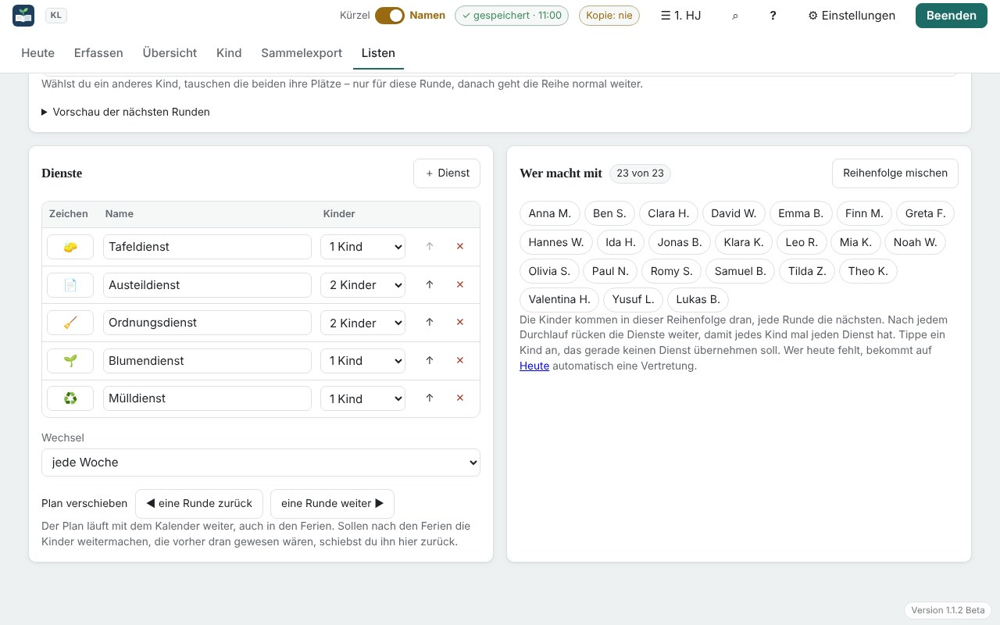{width="15.0cm"}

**Aushang drucken** druckt den Plan der gezeigten Runde in großer Schrift mit den Vornamen der Kinder, darunter die nächsten fünf Runden. So hängst du ihn in der Klasse auf und die Kinder sehen selbst, wann sie dran sind.

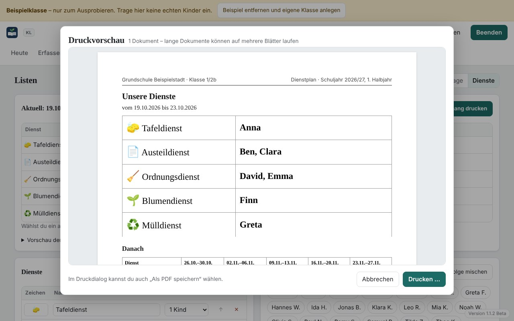{width="15.0cm"}

Auf **Heute** zeigt die Karte **Dienste**, wer gerade dran ist. Fehlt ein Kind, ist es durchgestrichen, und LeDoK nennt als Vertretung das nächste Kind der Reihe, das diesmal keinen Dienst hat und da ist.

**Auslosen.** Unter **Listen → Auslosen** ziehst du schnell ein Kind oder mehrere, bildest Gruppen oder lost eine Reihenfolge aus, zum Beispiel fürs Vorlesen, für Ämter oder für die Reihenfolge beim Vortragen. Am schnellsten geht es über den Knopf **🎲 Auslosen** auf **Heute** in der Karte „Wer fehlt heute?“ oder über die Schnellsuche (Strg+K bzw. ⌘K, dann „auslosen“).

**Los ziehen:** Wähle oben 1 bis 5 und klicke **🎲 Los ziehen**. Das Ergebnis steht groß im grünen Kasten. Darunter siehst du alle Lose im Topf: durchgestrichen ist, wer in dieser Runde schon gezogen wurde, rot umrandet, wer heute fehlt. War ein Kind gerade nicht greifbar, legt **Zurück in den Topf** die letzte Ziehung zurück, als hätte es sie nicht gegeben.

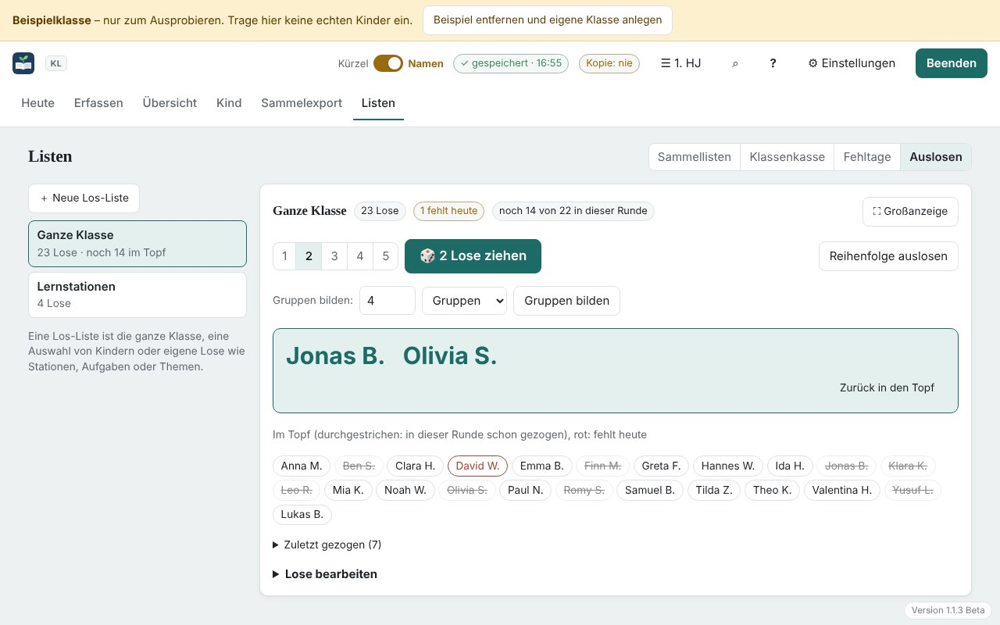{width="15.0cm"}

**Gerecht ziehen** ist bei jeder neuen Los-Liste eingeschaltet: Jedes Los kommt einmal dran, erst dann beginnt eine neue Runde. Die Runde bleibt gespeichert, auch über mehrere Tage. Reichen die übrigen Lose für eine Ziehung nicht, beginnt die neue Runde mitten in der Ziehung, ohne dass jemand doppelt gezogen wird. **Neue Runde beginnen** (unter „Lose bearbeiten“) legt alle Lose sofort zurück. Ohne „gerecht ziehen“ ist bei jeder Ziehung jedes Los wieder dabei.

**Gruppen bilden:** Gib eine Zahl ein und wähle **Gruppen** (so viele Gruppen) oder **je Gruppe** (so viele Kinder je Gruppe). LeDoK verteilt alle Anwesenden zufällig und gleichmäßig; die Gruppen unterscheiden sich höchstens um ein Kind. **Reihenfolge auslosen** mischt alle Lose zu einer nummerierten Liste. Gruppen und Reihenfolge druckst du mit **Drucken**. Unter **Zuletzt gezogen** stehen die letzten 20 Ergebnisse mit Datum und Uhrzeit.

**Eigene Los-Listen:** Mit **＋ Neue Los-Liste** legst du weitere Listen an. Unter **Lose bearbeiten** wählst du **ganze Klasse** (neue Kinder kommen von selbst dazu) oder **nur ausgewählte Kinder** (mit Schnellauswahl alle, keine oder nach Jahrgangsstufe). Dazu kannst du **eigene Lose** schreiben, eins pro Zeile, etwa Stationen, Aufgaben oder Themen. Ein Häkchen legt fest, ob Kinder übersprungen werden, die heute unter „Wer fehlt heute?“ als ganztags fehlend eingetragen sind. Die Beispielklasse enthält die Liste „Lernstationen“ mit vier Stationen.

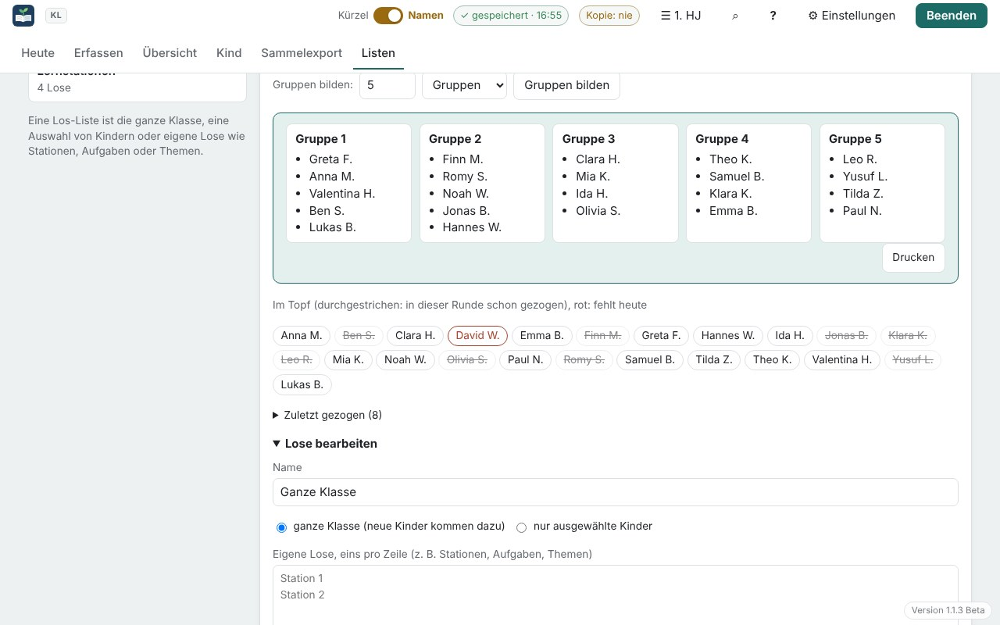{width="15.0cm"}

**Großanzeige:** **⛶ Großanzeige** füllt das ganze Fenster, damit die Klasse am Beamer oder an der Tafel mitsehen kann. Die Leertaste, Enter oder ein Klick in die Mitte zieht; die Namen werden kurz gemischt, dann steht das Ergebnis groß da. Im Kürzel-Modus zeigt LeDoK die Kürzel; **Vornamen zeigen** blendet Vorname und Anfangsbuchstaben des Nachnamens ein. Für echtes Vollbild drückst du zusätzlich F11 (Windows) bzw. ⌃⌘F oder nutzt Ansicht → Vollbild. Esc oder **Schließen** beendet die Großanzeige.

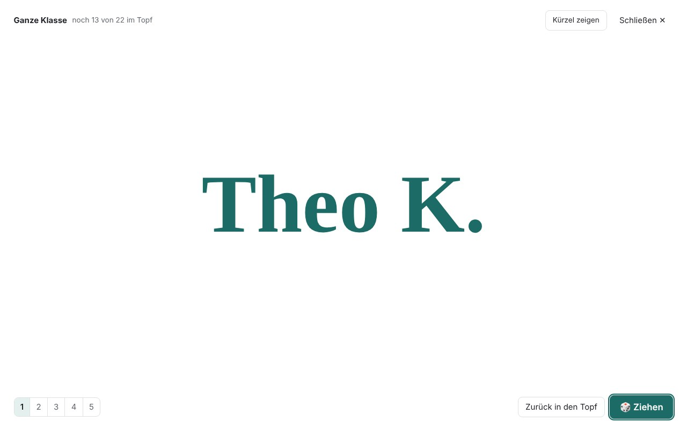{width="15.0cm"}

**Klassenrat.** Unter **Listen → Klassenrat** begleitet LeDoK euren Klassenrat vom Briefkasten bis zum unterschriebenen Protokoll. Oben wechselst du zwischen **Sitzungen**, **Briefkasten**, **Umfragen** und **Beschlüsse**.

**Briefkasten.** Hier sammelst du die Anliegen bis zur nächsten Sitzung. Wähle die Art (**👍 Ich lobe …**, **😟 Mich stört …** oder **💡 Ich wünsche mir …**), tippe das Anliegen ein, wähle auf Wunsch das Kind dazu und drücke Enter oder **In den Briefkasten**. **Anliegen-Zettel drucken** druckt acht Zettel je Seite zum Ausschneiden für einen echten Briefkasten im Klassenzimmer.

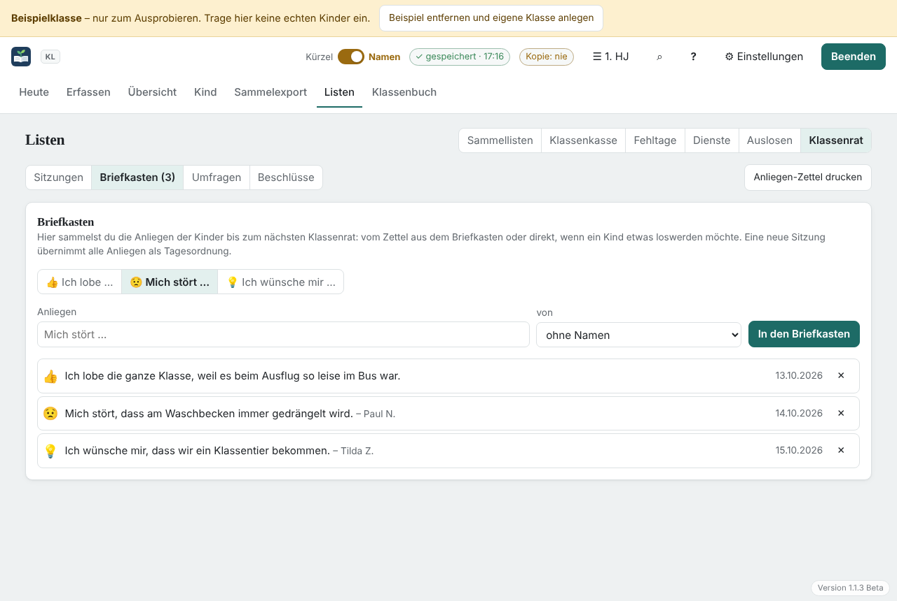{width="15.0cm"}

**Sitzung.** **＋ Neue Sitzung** legt die nächste Sitzung mit dem heutigen Datum an, übernimmt alle Anliegen aus dem Briefkasten als Tagesordnung und verteilt die Rollen **Leitung**, **Protokoll**, **Zeitwache** und **Regelwache** reihum an die nächsten Kinder, die heute da sind. Mit den Auswahlfeldern änderst du die Rollen, **reihum weitergeben** verteilt sie neu. Die Sitzung folgt dem üblichen Ablauf:

-   **1 · Positive Runde:** alle Lob-Anliegen zum Vorlesen.
-   **2 · Rückblick:** die Beschlüsse der letzten Sitzung und alle älteren, die noch offen sind. Für jeden klickst du **offen**, **umgesetzt** oder **verworfen**.
-   **3 · Anliegen:** je Anliegen ein Feld für Besprechung und Lösungsvorschläge, dazu **Beschluss**, **Wer kümmert sich?** und **bis**. **vertagen** legt ein Anliegen zurück in den Briefkasten. Unter **Anliegen nachtragen** ergänzt du, was erst in der Sitzung aufkommt.
-   **4 · Abstimmungen:** **Abstimmen …** bei einem Anliegen oder **＋ Abstimmung** startet eine Umfrage, die zur Sitzung gehört (siehe unten).
-   **5 · Blitzlicht:** Wie war der Klassenrat heute? Zähle mit ＋ und − die Kinder je Gesicht 😀 🙂 😐 🙁.

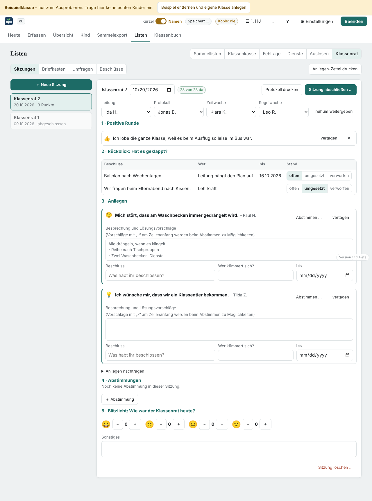{width="15.0cm"}

**Sitzung abschließen …** schließt die Sitzung. Anliegen ohne Besprechung und ohne Beschluss wandern dabei zurück in den Briefkasten. Eine abgeschlossene Sitzung kannst du lesen und drucken; **Wieder öffnen** macht sie wieder bearbeitbar. **Protokoll drucken** druckt das Protokoll mit Datum, Anwesenheit (aus den Fehltagen), Rollen, Lob, Rückblick, Anliegen mit Beschlüssen, Abstimmungsergebnissen und Blitzlicht sowie Unterschriftsfeldern für Leitung, Protokoll und Lehrkraft.

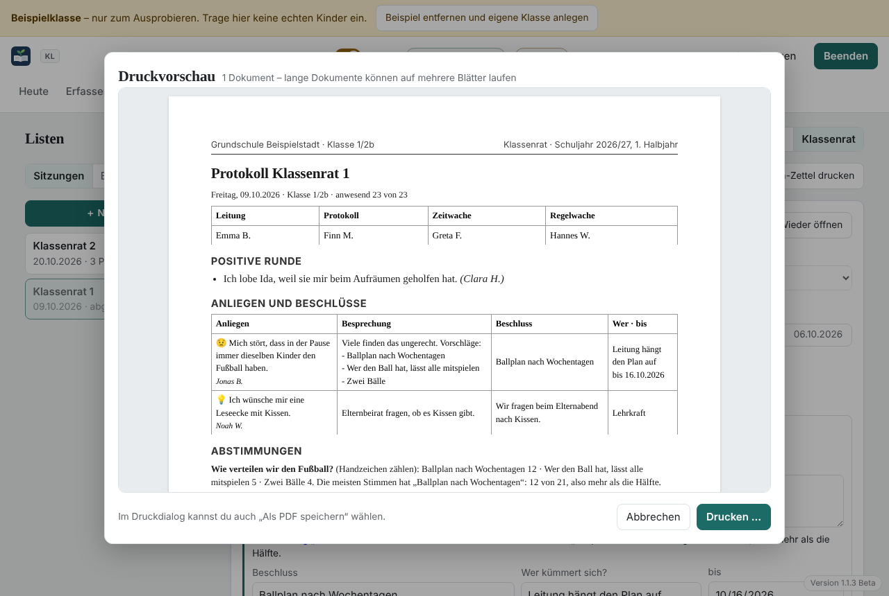{width="15.0cm"}

**Umfragen.** Abgestimmt wird über eine Umfrage, im Klassenrat oder einfach so, etwa über das Ziel des Wandertags. **＋ Neue Umfrage** fragt nach der Frage und den Antworten: **Ja oder nein**, **Daumen**, **Stimmungsbarometer** oder **Eigene Möglichkeiten** (eine pro Zeile). Startest du die Umfrage mit **Abstimmen …** bei einem Anliegen, stehen Vorschläge, die du in der Besprechung mit „-“ am Zeilenanfang notiert hast, schon als Möglichkeiten da.

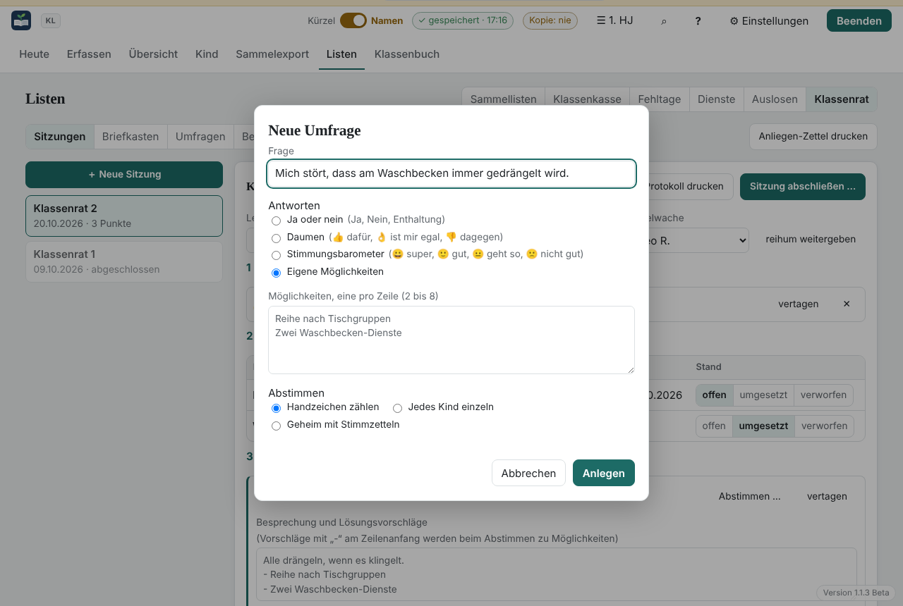{width="15.0cm"}

Es gibt drei Arten abzustimmen:

-   **Handzeichen zählen:** Hände zählen und je Stimme auf ＋ tippen.
-   **Jedes Kind einzeln:** bei jedem Kind die Wahl antippen. So siehst du, wer noch nicht abgestimmt hat.
-   **Geheim mit Stimmzetteln:** **Stimmzettel drucken** druckt genug Zettel für alle Kinder, die heute da sind. Die Kinder kreuzen an, du zählst die Zettel mit ＋ aus.

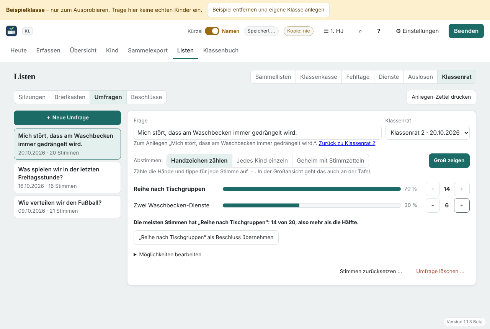{width="15.0cm"}

LeDoK zeigt die Stimmen als Balken und nennt, welche Möglichkeit die meisten Stimmen hat und ob das mehr als die Hälfte ist, oder einen Gleichstand. **Groß zeigen** öffnet eine Großansicht ohne Namen für Tafel oder Beamer; bei Handzeichen und Stimmzetteln zählst du dort direkt mit ＋ und −. Gehört die Umfrage zu einem Anliegen, trägt **… als Beschluss übernehmen** die Gewinner-Möglichkeit als Beschluss ein.

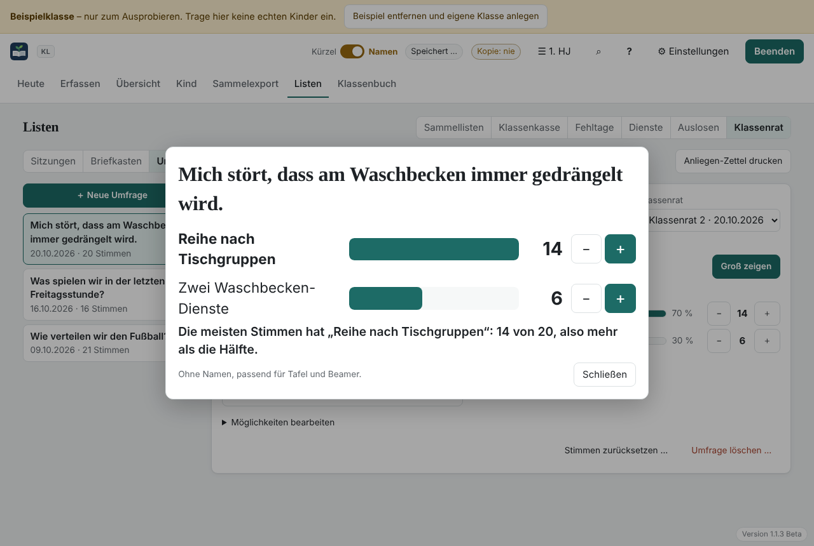{width="15.0cm"}

**Beschlüsse.** Hier stehen alle Beschlüsse mit Sitzung, Anliegen, Zuständigen und Frist, wahlweise nur die offenen oder alle. Überschrittene Fristen sind markiert. **Als Aushang drucken** druckt die Beschlüsse in großer Schrift für die Wand im Klassenzimmer, verworfene nicht.

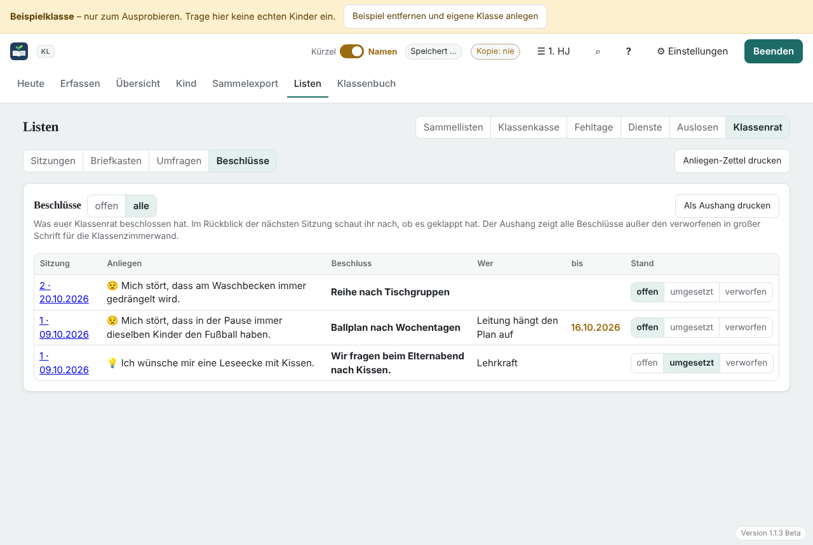{width="15.0cm"}

Löschst du ein Kind, bleiben seine Anliegen ohne Namen und seine Stimmen im Ergebnis erhalten. Wie alles in LeDoK werden Anliegen, Protokolle und Abstimmungen nur verschlüsselt gespeichert.

### 5.8 Klassenbuch

Im Reiter **Klassenbuch** hältst du fest, was du in jeder Stunde unterrichtet hast, und verknüpfst es mit den Lernzielen aus dem LehrplanPLUS. Oben rechts wechselst du zwischen **Woche** und **Lernziele**. Schülernamen stehen im Klassenbuch nicht; wer gefehlt hat, übernimmt LeDoK aus den Fehltagen.

**Woche.** Du siehst Montag bis Freitag der gewählten Kalenderwoche, heute ist umrandet. Mit **←** und **→** blätterst du, **Diese Woche** springt zurück. Die Stunden kommen aus deinem Stundenplan (Einstellungen → Stundenplan); ohne Stundenplan legst du sie mit **＋ Stunde** an.

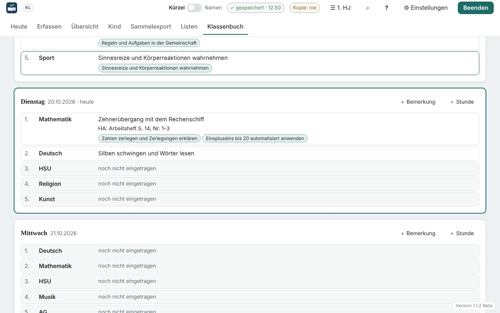{width="15.0cm"}

An schulfreien Tagen steht neben dem Datum, warum frei ist, zum Beispiel „Herbstferien“ oder „Buß- und Bettag“. Stunden aus dem Stundenplan erscheinen an diesen Tagen nicht; eine Bemerkung oder eine Stunde kannst du trotzdem eintragen. Auch die gedruckte Woche nennt die freien Tage.

-   Ein Klick auf eine Stunde öffnet den Eintrag: **Fach** (aus dem Stundenplan vorausgefüllt), **Thema / Inhalt**, **Hausaufgabe** und eine **Bemerkung**, z. B. „Vertretung“.
-   **＋ Bemerkung** gilt für den ganzen Tag, z. B. „Wandertag“ oder „Unterrichtsausfall“. Sie steht über den Stunden des Tages.
-   Kinder, die an einem Tag gefehlt haben, stehen neben dem Datum. Ein Klick ändert den Fehltag (Kapitel 5.7).
-   **Woche drucken** ergibt die Klassenbuchseite mit allen Stunden, Lernzielen, Hausaufgaben, Bemerkungen und Fehlenden, dazu Zeilen für deine Unterschrift und die Kenntnisnahme der Schulleitung.

**Lernziele verknüpfen.** Unter dem Text des Eintrags stehen die Lernziele des Fachs als Baum: Lernbereich, Kompetenz, Kompetenzerwartung. Ein Klick wählt ein Lernziel, ein zweiter oder das ✕ am Kärtchen entfernt es. Je Stunde sind bis zu 12 Lernziele möglich.

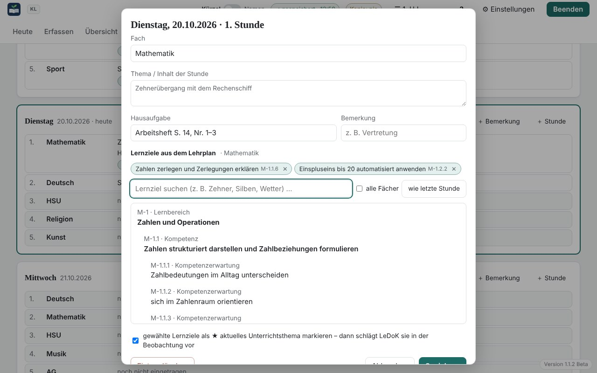{width="15.0cm"}

-   Im Suchfeld findest du ein Lernziel über ein Stichwort, z. B. „Zehner“ oder „Silben“. Gibt es im Fach keinen Treffer, sucht LeDoK in allen Fächern; mit **alle Fächer** suchst du gleich überall, etwa für fächerübergreifenden Unterricht.
-   **wie letzte Stunde** übernimmt die Lernziele der letzten Stunde im selben Fach. Das spart Zeit, wenn ein Thema über mehrere Stunden läuft.
-   Ist **gewählte Lernziele als ★ aktuelles Unterrichtsthema markieren** angehakt, werden sie beim Speichern ★-Themen. Sie erscheinen dann in der Beobachtung oben, auf Heute unter „★ Aktuelle Themen“ und im Stundenplan unter „Heute zum Beobachten“.
-   Ein Eintrag, in dem alle Felder leer sind, wird beim Speichern entfernt. **Eintrag löschen** fragt vorher nach.

**Lernziele.** Diese Übersicht zeigt je Fach, wie weit du im Lehrplan bist. Oben wählst du das Fach, den Zeitraum (1. Halbjahr, 2. Halbjahr oder Schuljahr) und ob alle, nur behandelte oder nur noch offene Lernziele erscheinen.

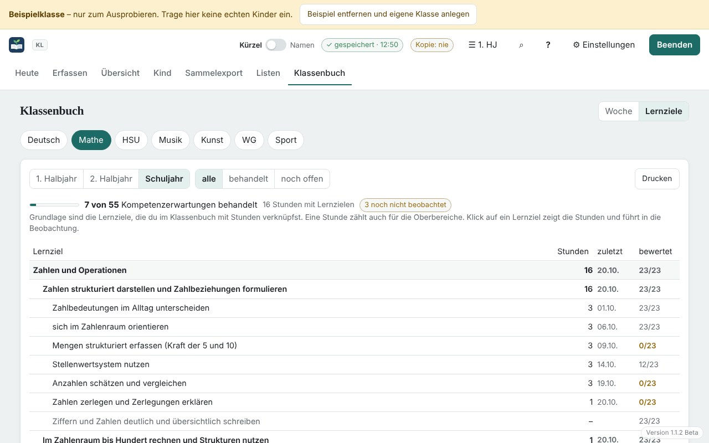{width="15.0cm"}

-   Der Balken zeigt, wie viele Kompetenzerwartungen im Zeitraum mindestens einmal behandelt wurden. Eine Stunde zählt auch für die Kompetenz und den Lernbereich darüber.
-   Je Zeile stehen die Zahl der Stunden, das Datum der letzten Stunde und bei wie vielen Kindern du dazu schon etwas bewertet hast. Orange heißt: im Unterricht behandelt, aber noch bei keinem Kind bewertet. Das Kästchen „noch nicht beobachtet“ oben zählt diese Lernziele.
-   Ein Klick auf ein Lernziel zeigt den Text des Lehrplans und alle Stunden dazu. **In der Beobachtung öffnen** springt direkt zum Bewerten, **★ als aktuelles Thema markieren** setzt oder entfernt den Stern.
-   **Drucken** ergibt eine Übersicht des Fachs mit allen Lernzielen und den Daten der Stunden, z. B. als Nachweis zum Halbjahr.

Auf **Heute** zeigt die Karte **Klassenbuch** die Stunden des Tages und wie viele schon eingetragen sind. Ein Klick genügt, um nach der Stunde Thema und Lernziele einzutragen.

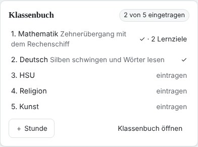{width="4.6cm"}

### 5.9 Einstellungen

Über **⚙ Einstellungen** erreichst du zehn Bereiche (als Fachlehrkraft drei).

**Klasse.** Schule, Klasse, Lehrkraft, Schuljahr und die Klassenliste. Weil sie Klarnamen enthält, fragt LeDoK hier noch einmal nach deinem Passwort. Je Kind trägst du Kürzel, Vorname, Nachname, Geburtsdatum, Klasse (eigene oder Parallelklasse), Jahrgangsstufe, Fokustag, Fächer, Lernniveau und Pronomen ein. Mit **Mehrere auf einmal …** legst du viele Kinder schnell an, mit **Kind importieren …** übernimmst du eine Übergabedatei oder eine LeDoK-CSV. **Fokustage neu verteilen** verteilt alle Kinder gleichmäßig auf Montag bis Freitag.

**Stundenplan.** Trag ein, welches Fach du in welcher Stunde hast: oben die Zahl der **Stunden am Tag** (4 bis 8), links auf Wunsch die Uhrzeit, zu der die Stunde beginnt, dann je Wochentag das Fach. Fächer aus „Fächer & Raster“ erkennt LeDoK auch abgekürzt (z. B. „Mathe“) und färbt sie grün; andere Einträge wie „Religion“ oder „AG“ erscheinen nur im Plan. **Drucken** gibt den Stundenplan aus. Auf **Heute** zeigt LeDoK dann die Stunden des Tages (5.2).

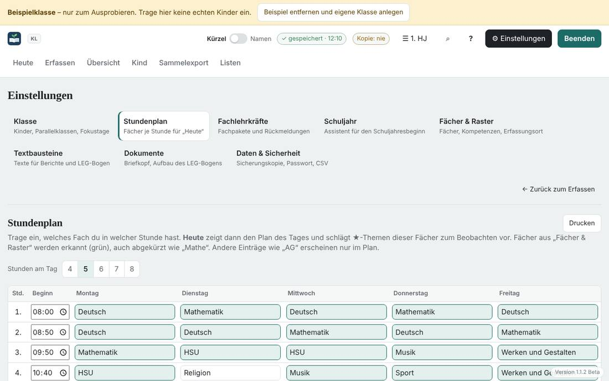{width="15.0cm"}

**Fachlehrkräfte.** Siehe Kapitel 6.

**Schuljahr.** Der Schuljahres-Assistent führt in 12 Schritten durch den Wechsel. Die Haken setzt du selbst; sie werden je Schuljahr gespeichert.

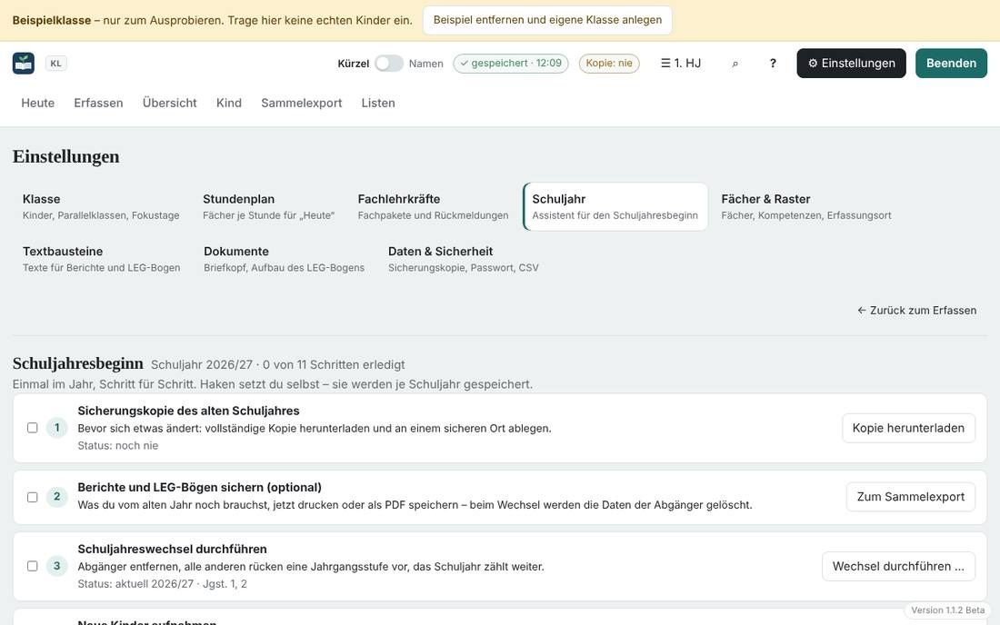{width="15.0cm"}

1.  Sicherungskopie des alten Schuljahres
2.  Berichte und LEG-Bögen sichern (optional)
3.  Schuljahreswechsel: Abgänger entfernen, alle anderen rücken eine Jahrgangsstufe vor („1c“ wird „2c“). Die Arbeitsdaten der Abgänger werden gelöscht; vorher legt LeDoK automatisch eine Sicherung an.
4.  Neue Kinder aufnehmen
5.  Lernniveau prüfen
6.  Lehrplan einspielen (Standardvorlage oder eigene CSV)
7.  Fächer prüfen
8.  Fokustage verteilen
9.  Halbjahr auf 1 stellen
10. Ferien und freie Tage prüfen
11. ★-Markierungen zurücksetzen
12. Sicherungskopie des neuen Stands

**Ferien & Feiertage.** Die Schulferien in Bayern nach der Ferienordnung des Kultusministeriums (bis zu den Sommerferien 2030) und die gesetzlichen Feiertage sind in LeDoK hinterlegt und funktionieren ohne Internet. Oben wählst du das Schuljahr. Du siehst den ersten und den letzten Schultag, die Zahl der Schultage, eine Liste aller Ferien und freien Tage und die Monate von September bis August mit Ferien (gelb), Feiertagen (rot) und unterrichtsfreien Tagen (grün). **Drucken** gibt den Ferienkalender auf einer Seite aus, zum Beispiel für die Pinnwand.

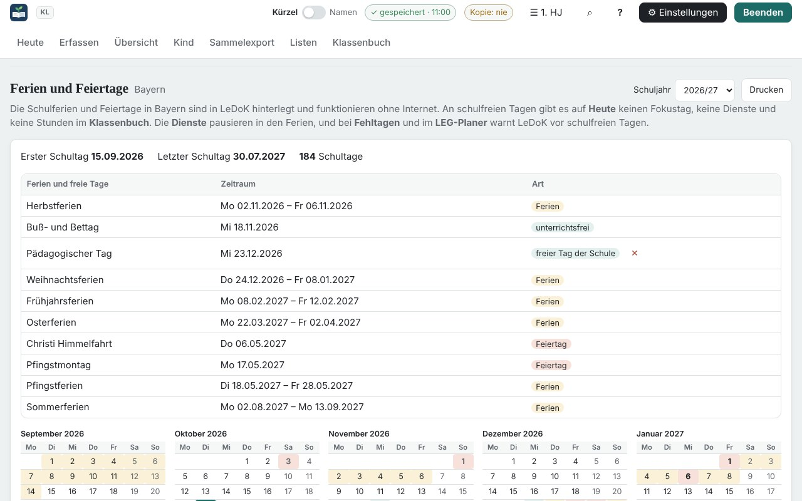{width="15.0cm"}

Unter **Freie Tage deiner Schule** trägst du zusätzliche schulfreie Tage ein, etwa einen pädagogischen Tag oder den Ausgleich für ein Schulfest am Samstag: Datum, auf Wunsch „bis“ und eine Bezeichnung, dann **Eintragen**. Sie zählen in LeDoK wie Ferien, mit ✕ löschst du einen Eintrag. Sind die Ferien eines Schuljahres noch nicht hinterlegt, kannst du sie hier vorläufig selbst eintragen, bis ein Update sie mitbringt.

LeDoK nutzt den Kalender auf Heute (5.2), im Klassenbuch (5.8), bei Diensten und Fehltagen (5.7) und im LEG-Planer (5.6). Beim Erfassen steht neben einem schulfreien Datum, warum frei ist, und bei einer Sammelliste warnt ⚠, wenn die Frist auf einen schulfreien Tag fällt.

**Fächer & Raster.** Drei Unterreiter:

-   **Kompetenzraster:** der Baum aus Lernbereich → Kompetenz → Kompetenzerwartung → Teilbereich. Ein Klick auf einen Bereich öffnet die Bearbeitung: Bezeichnung, Halbjahr (1. und/oder 2.), Erwartung je Jahrgangsstufe, sichtbar ja/nein, ★ aktuell und die **Erfassung** (Beobachtung, Fokustag, Fokuswoche, nur beim Kind, nicht erfassen), auf Wunsch getrennt je Jahrgangsstufe.
-   **Bewertungsebene (◎ Hier bewerten):** Setzt du bei einem Oberbereich „Hier bewerten“, bewertest du ihn als Ganzes. Seine Unterbereiche werden nicht mehr einzeln erfasst, sondern erscheinen beim Bewerten als „Worauf achten“. Das ist praktisch, wenn dir der Lehrplan zu kleinteilig ist.
-   **Bewertungsebene pauschal festlegen:** Mit „Bewertungsebene in …“ über dem Raster legst du für ein ganzes Fach fest, ob du auf der Ebene der Lernbereiche (LB), Kompetenzen (K) oder Kompetenzerwartungen (KE) bewertest oder „einzeln“ bis zu den Teilbereichen. LeDoK setzt dann bei allen Bereichen dieser Ebene „Hier bewerten“. Einzelne Bereiche stellst du danach anders ein: Klicke zum Beispiel einen Lernbereich an und wähle unter „Bewertungsebene für alle Unterbereiche“ eine feinere Ebene. Ist ein Fach unterschiedlich eingestellt, steht dort „gemischt“. Die Erfassung (Beobachtung, Fokustag …) übernimmt jeder Bereich von seinen Unterbereichen; am häufigsten gewählt gewinnt. Bisherige Bewertungen bleiben erhalten und fließen weiter in Übersicht, Bericht und LEG-Bogen ein.
-   **Fächer verwalten:** Fächer ein- und ausblenden (z. B. Religionslehre, Ethik, Deutsch als Zweitsprache, Englisch 3/4), festlegen, ob ein Fach benotet wird und auf welcher Ebene der Bericht formuliert. Ausgeblendete Fächer behalten ihre Daten.
-   **Lehrplan austauschen:** den Lehrplan als CSV herunterladen, in Excel oder LibreOffice anpassen und wieder einspielen, oder die Standardvorlage neu einspielen. Bewertungen bleiben erhalten. Tipp für Excel: die Spalte „Nummer“ als Text formatieren, sonst wird aus 1.1 ein Datum.

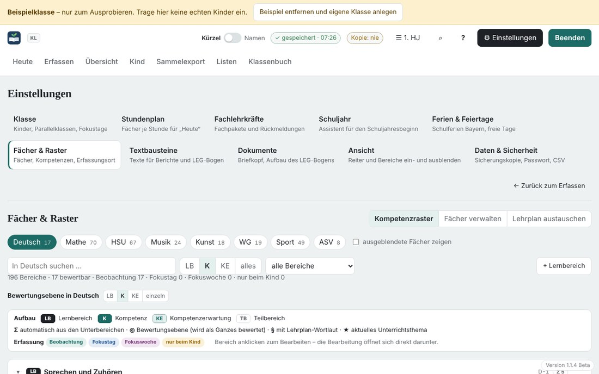{width="15.0cm"}

**Jahrgangsstufe 3/4.** LeDoK enthält den LehrplanPLUS für 1/2 und für 3/4 sowie Deutsch als Zweitsprache 1–4. Welche Fächer eingeblendet sind, richtet sich nach den Jahrgangsstufen beim Einrichten. Hast du Kinder einer Jahrgangsstufe, für die kein passendes Fach eingeblendet ist, zeigt LeDoK oben einen gelben Hinweis mit dem Knopf **Fächer 3/4 einblenden** (bzw. 1/2).

**Textbausteine.** Sätze für Bericht (3. Person) und LEG-Bogen (Du-Form) je Stufe, Notiz-Bausteine und Satzmuster. Platzhalter: `{Vorname}` (wechselt bei hinterlegtem Pronomen mit „sie/er“), `{Name}`, `{Fach}`, `{Liste}`, `{Kompetenz}`. Regel: beobachtbar statt Etikett, Stärke zuerst.

**Dokumente.** Hier legst du fest, wie LEG-Bögen, Berichte und Listen gedruckt aussehen. Rechts siehst du sofort eine Vorschau für ein Kind deiner Wahl, umschaltbar zwischen LEG-Bogen, Bericht und Einladung. Im Kürzel-Modus zeigt die Vorschau keine Namen.

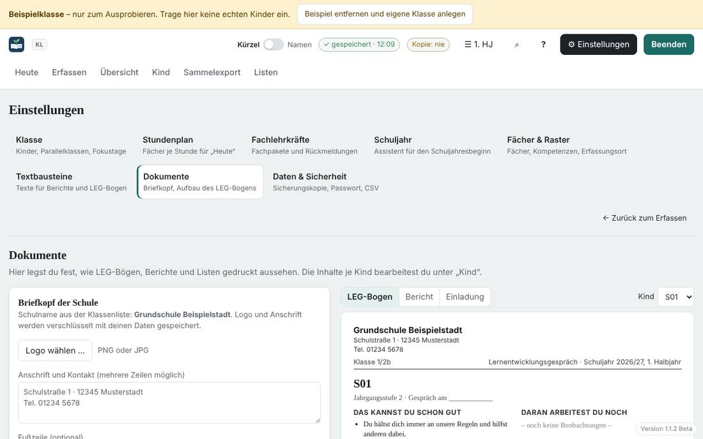{width="15.0cm"}

-   **Briefkopf der Schule:** Mit **Logo wählen …** liest du ein Logo als PNG oder JPG ein; LeDoK verkleinert es automatisch. Darunter trägst du Anschrift und Kontakt (mehrere Zeilen) und optional eine Fußzeile ein, z. B. „Vertraulich – nur für das Gespräch mit den Eltern“. Den Schulnamen übernimmt LeDoK aus der Klassenliste. Mit den Haken bei **Verwenden für** entscheidest du, ob der Briefkopf auf LEG-Bögen, Berichten und/oder Listen, Verlauf und Proben erscheint. Logo und Anschrift werden verschlüsselt mit deinen Daten gespeichert.

-   **Druckbild:** gilt für alle Ausdrucke, für die Vorschau hier und für die Druckvorschau. Du wählst die **Schriftgröße** (klein, normal, groß, sehr groß) und die **Schriftart** (mit Serifen wie Georgia oder ohne Serifen wie Arial). Mit **Logo und Diagramme in Graustufen** sparst du Farbe am Schulkopierer. Größere Schrift hilft Eltern beim Lesen, braucht aber mehr Seiten.

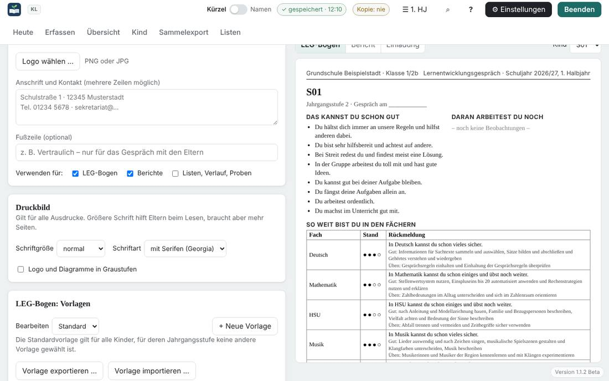{width="15.0cm"}

-   **LEG-Bogen: Vorlagen:** Du kannst mehrere Fassungen des LEG-Bogens anlegen, z. B. eine kindgerechte für Jahrgangsstufe 1. **+ Neue Vorlage** legt eine Kopie der gerade gezeigten Vorlage an und fragt nach einem Namen. Unter **Gilt für Jahrgangsstufe** hakst du 1 bis 4 an; jede Jahrgangsstufe gehört immer nur zu einer Vorlage. Für alle übrigen Kinder gilt die Vorlage **Standard**. Mit **Bearbeiten** wählst du, welche Vorlage du darunter bearbeitest. **Vorlage löschen** gibt es nur für weitere Vorlagen, nicht für Standard. Unter **Kind → LEG-Bogen** zeigt die Vorschau die Vorlage des Kindes. Beim Drucken der LEG-Bögen kannst du unter **Vorlage** auch eine andere wählen: automatisch nach Jahrgangsstufe, Standard oder eine benannte Vorlage.

-   **LEG-Bogen: Abschnitte:** Der Bogen besteht aus Abschnitten (Persönliche Worte, Stärken, Übungsfelder, Fächertabelle, Selbsteinschätzung, Ziele, Vereinbarung, Unterschriften und die Seite „Lernverlauf“ mit Diagrammen). Mit dem Haken schaltest du einen Abschnitt ein oder aus, im Feld darunter änderst du die Überschrift, mit ↑ ↓ die Reihenfolge. Stärken und Übungsfelder stehen nebeneinander, wenn sie direkt aufeinander folgen. Beim Abschnitt Selbsteinschätzung trägst du die Sätze ein, die das Kind mit 😀 🙂 😕 ankreuzt (ein Satz pro Zeile).

-   **Freitext-Abschnitte:** Mit **+ Freitext-Abschnitt** fügst du eigene Texte hinzu, z. B. „Liebe Eltern, am {Datum} sprechen wir über die Lernentwicklung von {Vorname}.“ Auf Wunsch druckt LeDoK darunter bis zu sechs Schreiblinien. Mögliche Platzhalter: `{Vorname}`, `{Name}`, `{Klasse}`, `{Jgst}`, `{Schule}`, `{Schuljahr}`, `{Halbjahr}`, `{Lehrkraft}`, `{Datum}`, `{Stärken}`, `{Übungsfelder}`, `{Ziele}` sowie {Termin} für den Gesprächstermin aus dem LEG-Planer. Mit ✕ entfernst du einen Freitext wieder.

-   **Aufbau zurücksetzen** stellt bei der gerade bearbeiteten Vorlage die ursprünglichen Abschnitte, Überschriften und Sätze zur Selbsteinschätzung wieder her.

-   **Vorlagen mit Kolleginnen und Kollegen teilen:** **Vorlage exportieren …** speichert die gerade bearbeitete Vorlage als Datei `LeDoK-Vorlage-<Name>.ledok-vorlage`, auf Wunsch mit deinem Briefkopf (Logo, Anschrift, Fußzeile). Die Datei enthält nur Abschnitte, Überschriften, Freitexte und Sätze zur Selbsteinschätzung, keine Schülerdaten, und ist deshalb nicht verschlüsselt. **Vorlage importieren …** fügt sie bei dir als neue Vorlage hinzu; gibt es den Namen schon, bekommt sie ein „(2)“ dahinter. Enthält die Datei einen Briefkopf, fragt LeDoK, ob er deinen eigenen ersetzen soll. Danach wählst du, für welche Jahrgangsstufen die neue Vorlage gilt.

-   **Einladung zum LEG:** Überschrift und Text des Elternbriefs, den du im Sammelexport → LEG-Planer druckst. Eine Leerzeile beginnt einen neuen Absatz. `{Termin}` wird durch Wochentag, Datum und Uhrzeit ersetzt; alle anderen Platzhalter gelten auch hier. Mit **Abschnitt zum Zurückgeben anhängen** bekommt der Brief einen Abschnitt, auf dem die Eltern zu- oder absagen. **Text zurücksetzen** stellt den mitgelieferten Text wieder her. In der Vorschau rechts zeigt der Reiter **Einladung** den Brief.

Was auf dem Bogen für ein einzelnes Kind steht (Stärken, Ziele, persönliche Worte), bearbeitest du weiterhin unter **Kind**.

**Ansicht.** Hier blendest du aus, was du nicht brauchst: Reiter (außer Heute), Arten zu erfassen (Beobachtung, Fokustag, Fokuswoche, Probe, Lern-App; eine bleibt immer sichtbar), die Bereiche im Reiter Listen und die Karten auf Heute. Entferne dazu den Haken; die Änderung gilt sofort. Sind alle Bereiche unter Listen ausgeblendet, verschwindet auch der Reiter Listen.

Ausblenden versteckt nur Knöpfe und Karten. Deine Daten bleiben vollständig erhalten, und Links aus anderen Bereichen führen weiterhin hin, zum Beispiel Fokustag starten auf Heute. Hängt eine Karte an einem ausgeblendeten Bereich, etwa die Karte Klassenbuch am Reiter Klassenbuch, verschwindet sie mit und LeDoK sagt dir das in der Liste. Auch die Schnellsuche bietet ausgeblendete Reiter und Listen nicht mehr an. Alles wieder einblenden stellt den Ausgangszustand her. Die Einstellung gilt für dieses LeDoK.

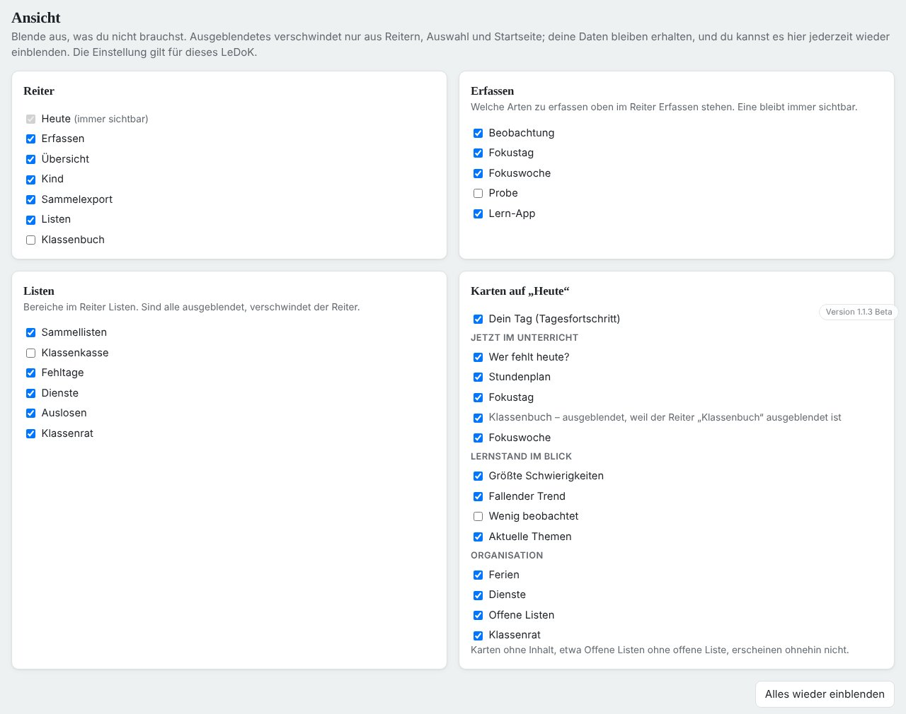{width="15.0cm"}

**Daten & Sicherheit.** Speicherort, Sicherungskopie, Schulschlüssel, Passwort, CSV, Datenprüfung und Löschen. Siehe Kapitel 7 und 8.

## 6 · Zusammenarbeit: Fachpaket und Rückmeldung

Klassenlehrkraft und Fachlehrkraft tauschen Daten über zwei verschlüsselte Dateien aus, ganz ohne Server: Das **Fachpaket** geht von der Klassenlehrkraft zur Fachlehrkraft, die **Rückmeldung** zurück.

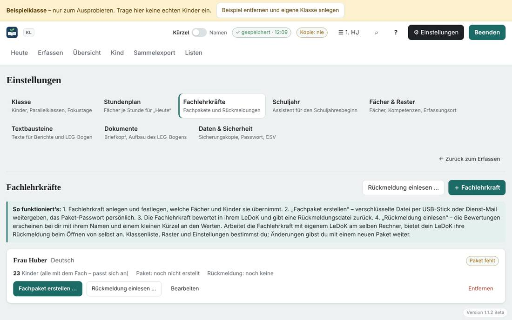{width="15.0cm"}

### Als Klassenlehrkraft

1.  **Fachlehrkraft anlegen:** Einstellungen → **Fachlehrkräfte** → **＋ Fachlehrkraft**. Name eintragen, Fächer ankreuzen und auf Wunsch „bewertet auch das Arbeits- und Sozialverhalten mit“. Bei den Kindern wählst du „alle Kinder, die das Fach haben“ (passt sich automatisch an) oder eine Auswahl.
2.  **Festlegen, was weitergegeben wird:** auf Wunsch Vornamen und Anfangsbuchstaben der Nachnamen (sonst nur Kürzel) und die bisherigen Bewertungen in diesen Fächern als Verlauf. Immer dabei sind Kürzel, Jahrgangsstufe, Lernniveau, Fokustag, Raster und Erfassungseinstellungen dieser Fächer. **Nie** weitergegeben werden volle Nachnamen, Geburtsdaten, Notizen und Bewertungen anderer Fächer.
3.  **Fachpaket erstellen …:** Paket-Passwort vergeben (mindestens 8 Zeichen). LeDoK speichert eine Datei `fachpaket-…-v1.ledok`. Gib sie per USB-Stick oder Dienst-Mail weiter und sag das Passwort **persönlich**, nicht in derselben Mail.
4.  **Rückmeldung einlesen …:** Die Datei der Fachlehrkraft wählen. Ein Passwort brauchst du nicht; nur dein LeDoK kann sie öffnen. LeDoK zeigt vorher, wie viele Bewertungen neu, geändert oder gelöscht sind, und du bestätigst mit **Übernehmen**.

Die Bewertungen erscheinen bei dir mit dem Namen der Fachlehrkraft und einem kleinen Kürzel an den Werten. Sie fließen in Übersicht, Berichte und LEG ein. Eine neue Rückmeldung ersetzt die frühere derselben Fachlehrkraft; deine eigenen Bewertungen bleiben unberührt. Rückmeldungen kannst du beliebig oft einlesen, doppelte Einträge entstehen nicht.

**Status auf der Karte jeder Fachlehrkraft**

| Status             | Bedeutung                                                          |
|------------------------------------|------------------------------------|
| Paket fehlt        | noch kein Fachpaket erstellt                                       |
| Neues Paket nötig  | Kinderliste oder Raster haben sich seit dem letzten Paket geändert |
| Rückmeldung fällig | noch keine Rückmeldung oder die letzte ist älter als 4 Wochen      |
| aktuell            | alles auf dem neuesten Stand                                       |
| Neue Rückmeldung   | am selben Rechner liegt eine Rückmeldung bereit (siehe unten)      |

### Als Fachlehrkraft

1.  **Fachpaket importieren …** auf der Willkommensseite oder unter Einstellungen → **Fachpakete**. Datei wählen, Paket-Passwort eingeben.
2.  LeDoK übernimmt Kinderliste, Raster und Einstellungen genau so, wie die Klassenlehrkraft sie festgelegt hat. Du kannst gleich im Reiter **Erfassen** loslegen.
3.  **Rückmeldung erstellen:** Einstellungen → Fachpakete → **Rückmeldung erstellen** (oder die Karte „Rückmeldungen“ auf **Heute** anklicken). LeDoK speichert eine Datei, die du der Klassenlehrkraft per USB-Stick gibst. Ein Passwort ist nicht nötig.
4.  Mach das regelmäßig. Die Karte zeigt, wie viele Einträge seit der letzten Rückmeldung neu sind.

Ein neueres Fachpaket derselben Klasse aktualisiert Kinderliste und Raster; deine Bewertungen bleiben erhalten. Fällt ein Kind aus dem Paket heraus, bleibt es bei dir, bis seine noch nicht zurückgemeldeten Bewertungen in einer Rückmeldung stecken. Du kannst Pakete mehrerer Klassen nebeneinander haben.

### Am selben Rechner ohne USB-Stick

Arbeiten Klassenlehrkraft und Fachlehrkraft am selben Rechner mit je einem eigenen LeDoK (Kapitel 3, „Mehrere Lehrkräfte an einem Rechner“), geht die Rückmeldung automatisch:

1.  Das LeDoK der Fachlehrkraft legt ihre Bewertungen beim Speichern verschlüsselt auf dem Rechner bereit. Nur das LeDoK der Klassenlehrkraft kann sie öffnen.
2.  Öffnet die Klassenlehrkraft ihr LeDoK, bietet es die Rückmeldung von selbst an. Sie prüft die Zahlen und klickt auf **Übernehmen** oder **Später**.
3.  Mit „Später“ steht auf der Karte der Fachlehrkraft **Neue Rückmeldung auf diesem Rechner ansehen …**.

Das Fachpaket selbst gibst du auch am selben Rechner einmal als Datei weiter. Kein LeDoK öffnet dabei die Daten eines anderen.

## 7 · Datensicherung, Wiederherstellung und Löschen

LeDoK speichert jede Eingabe sofort verschlüsselt. Eine **Sicherungskopie** ist eine zweite, ebenfalls verschlüsselte Datei (`.lernstand`), die dich vor Defekt, Verlust oder versehentlichem Löschen schützt. Sie öffnet sich nur mit dem Passwort, das beim Anlegen der Kopie galt.

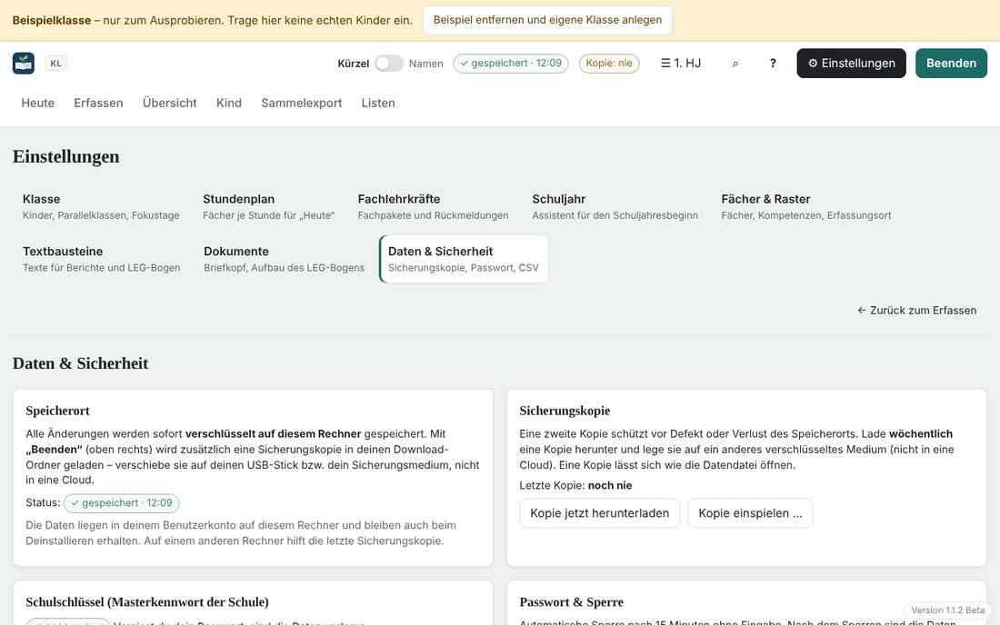{width="15.0cm"}

### Automatische Sicherungen

In der Desktop-App landen alle automatischen Sicherungen im Ordner `Dokumente/LeDoK-Sicherungen`. Du öffnest ihn über das Menü **Datei → Sicherungsordner öffnen** oder im Versionsdialog über **Sicherungen anzeigen**.

| Wann                                                 | Dateiname beginnt mit                                |
|------------------------------------|------------------------------------|
| bei jedem Klick auf **Beenden**                      | `ledok-sicherung-kopie-`                             |
| beim Schließen des Fensters, höchstens einmal am Tag | `ledok-sicherung-tag-`                               |
| vor dem Löschen von Daten                            | `ledok-sicherung-vor-loeschen-`                      |
| vor dem Löschen eines einzelnen Kindes               | `ledok-sicherung-vor-kind-loeschen-`                 |
| vor dem Schuljahreswechsel                           | `ledok-sicherung-vor-schuljahreswechsel-`            |
| vor dem Einspielen einer Kopie                       | `ledok-sicherung-vor-einspielen-`                    |
| vor dem Aufräumen in der Datenprüfung                | `ledok-sicherung-vor-aufraeumen-`                    |
| vor einem Update oder dem Zurücksetzen eines Updates | `ledok-sicherung-vor-update-` / `vor-zuruecksetzen-` |
| wenn das normale Speichern fehlschlägt               | `ledok-sicherung-notfall-`                           |

Von jeder Art bleiben die 15 neuesten liegen, ältere löscht LeDoK selbst. Zusätzlich liegt neben der Datendatei eine `.vorher`-Datei mit dem vorletzten Stand.

In der **Browser-Fassung** lädt LeDoK die Kopie stattdessen in deinen Download-Ordner, beim Beenden höchstens einmal am Tag.

### Was du selbst tun solltest

-   **Wöchentlich** eine Kopie auf einen verschlüsselten USB-Stick oder ein anderes verschlüsseltes Medium legen, nicht in eine Cloud. Am einfachsten: **Datei → Sicherungsordner öffnen** und die neueste Datei kopieren, oder unter **Einstellungen → Daten & Sicherheit** auf **Kopie jetzt herunterladen** klicken.
-   Oben in der Kopfzeile erinnert dich „Kopie: nie“ oder „Kopie vor n Tagen“, wenn die letzte Kopie älter als 7 Tage ist.
-   Nach einer Passwortänderung, nach dem Einlesen des Schulschlüssels und nach dem Ausschalten des Hersteller-Supports gleich eine neue Kopie anlegen.

### Eine Kopie einspielen

1.  Auf dem Startbildschirm **Sicherungskopie laden …** oder unter **Einstellungen → Daten & Sicherheit** auf **Kopie einspielen …** klicken.
2.  Die `.lernstand`-Datei wählen und das Passwort eingeben, mit dem die Kopie erstellt wurde. Es gilt danach für deine Daten.
3.  LeDoK vergleicht die Zeitstände. Ist die Kopie älter als deine aktuellen Daten, warnt es ausdrücklich. Vor dem Ersetzen legt LeDoK automatisch eine Sicherung deines aktuellen Stands an.

### Daten löschen

Die Löschfunktionen für echte Daten legen vorher automatisch eine verschlüsselte Sicherung an. Zur Bestätigung tippst du **LÖSCHEN** ein.

| Funktion               | Wo                                                                                               | Was passiert                                                                                  |
|------------------------|------------------------|------------------------|
| Beispiel entfernen     | gelbes Band oben                                                                                 | löscht nur die Beispielklasse, mit einer einfachen Rückfrage                                  |
| Schülerdaten löschen … | Daten & Sicherheit                                                                               | löscht Kinder, Einträge, Freitexte und Texte; Raster, Textbausteine und Einstellungen bleiben |
| Dieses LeDoK löschen … | Daten & Sicherheit oder Startbildschirm → Weitere Optionen (wenn mehrere LeDoKs am Rechner sind) | löscht nur dein LeDoK; die LeDoKs der anderen Lehrkräfte bleiben erhalten                     |
| Alles löschen …        | wie oben, wenn nur ein LeDoK am Rechner ist                                                      | löscht alle LeDoK-Daten auf diesem Rechner bzw. in diesem Browser                             |

Die Sicherung „vor-loeschen“ holst du mit dem bisherigen Passwort über **Sicherungskopie laden** zurück.

### Datenprüfung

Unter **Einstellungen → Daten & Sicherheit → Daten prüfen** sucht LeDoK nach Resten, die zu keinem Kind oder Thema mehr gehören, etwa nach dem Löschen eines Kindes in einer älteren Version oder nach einem Import. Gezählt werden Bewertungen zu Kindern oder Themen, die es nicht mehr gibt, sowie Notizen, Berichte und LEG-Texte, Förderpläne und Fehltage ohne Kind. Ist alles in Ordnung, sagt LeDoK das. Sonst zeigt es die Zahlen und bietet **Aufräumen** an; vorher legt es automatisch eine Sicherung an. Bewertungen mit einem Datum in der Zukunft werden nur gemeldet, nicht gelöscht. Prüfe sie unter **Kind**.

### CSV-Export und -Import

Unter **Daten & Sicherheit** kannst du alle Bewertungen und Freitexte der Klasse als Tabelle herunterladen, nur mit Kürzeln und ohne Namen. Die Datei ist **unverschlüsselt**: Speichere sie nur auf dem verschlüsselten Gerät und lösche sie nach Gebrauch. Beim Import entscheidest du für jedes Kürzel, ob ein neues Kind angelegt oder ein bestehendes ergänzt wird. Der Import von Klassenlisten aus anderen Programmen ist geplant, aber noch nicht enthalten.

## 8 · Passwort, Schulschlüssel und der LeDoK-Admin

### Dein Passwort

-   **Passwort ändern:** Einstellungen → Daten & Sicherheit → **Passwort ändern …**. Erst das aktuelle, dann zweimal das neue Passwort (mindestens 8 Zeichen) eingeben. LeDoK verschlüsselt die Daten dabei mit einem neuen Schlüssel. Ältere Kopien öffnen weiter mit dem alten Passwort; lege deshalb gleich eine neue Kopie an.
-   **Jetzt sperren:** gleich daneben, oder im Menü ☰.
-   **Passwort vergessen:** Ohne Schulschlüssel gibt es keinen Weg zurück, außer einer Sicherungskopie mit bekanntem Passwort. Mit Schulschlüssel hilft dir der LeDoK-Admin (siehe unten).

### Der Schulschlüssel

Der Schulschlüssel ist eine Datei `.ledok-schule`, die der LeDoK-Admin einmal für die ganze Schule erstellt. Liest du ihn ein, verschlüsselt LeDoK alles zusätzlich so, dass der LeDoK-Admin es mit dem Masterkennwort der Schule wieder öffnen kann: deine Daten, Sicherungskopien, Übergabedateien und Fachpakete. Im Alltag sieht der Admin nichts.

**So liest du ihn ein:** beim Einrichten (Kapitel 3) oder später unter **Einstellungen → Daten & Sicherheit → Schulschlüssel einlesen …**. LeDoK prüft die Signatur der Schule und zeigt den Fingerabdruck (z. B. `1A2B-3C4D-5E6F-7A8B-9C0D`). Vergleiche ihn mit dem Aushang deines LeDoK-Admins. Danach steht dort „✓ hinterlegt“ mit Name, Fingerabdruck und Version. Lade anschließend eine neue Sicherungskopie herunter: Ältere Kopien ohne Schulschlüssel sind nicht geschützt.

**Sicherheit:** Eine veränderte Datei oder eine, die sich als Schlüssel deiner Schule ausgibt, aber nicht vom eigenen LeDoK-Admin stammt, lehnt LeDoK ab. Den Schlüssel einer anderen Schule übernimmt es nur nach einer deutlichen Warnung, wenn du die ersten Zeichen des Fingerabdrucks eintippst.

**Protokoll:** Unter dem Schulschlüssel steht ein Protokoll. Dort siehst du jede Wiederherstellung durch den LeDoK-Admin oder den Hersteller-Support, jedes eingelesene Fachpaket und jede Änderung am Support.

### Aufgaben des LeDoK-Admins

Den Bereich öffnest du auf dem Startbildschirm über **LeDoK-Admin …**. Er braucht keine Klasse, nur das Masterkennwort.

{width="15.0cm"}

**1 · Schulschlüssel erstellen** (einmal pro Schule)

1.  Name der Schule und ein Masterkennwort (mindestens 12 Zeichen) zweimal eingeben, **Schulschlüssel erstellen** klicken.
2.  Die Datei `Schulschluessel-….ledok-schule` liegt im Download-Ordner. Sie enthält kein Kennwort und darf per Dienst-Mail an alle Lehrkräfte gehen.
3.  **Notfallblatt drucken**, das Masterkennwort von Hand eintragen und versiegelt im Schultresor verwahren. Öffnen nur im Vier-Augen-Prinzip (Schulleitung und Datenschutzbeauftragte/r) und mit Vermerk.
4.  Den Fingerabdruck im Lehrerzimmer aushängen.

**2 · Zugang wiederherstellen** (Passwort vergessen)

1.  Am Gerät der Lehrkraft LeDoK öffnen → **LeDoK-Admin …** → **Zugang wiederherstellen**.
2.  **Daten auf diesem Rechner** wählen, oder **Datei wählen …** für eine Sicherungskopie, Übergabedatei oder ein Fachpaket.
3.  Masterkennwort eingeben, dann zweimal ein neues Passwort für die Lehrkraft.
4.  Die Lehrkraft meldet sich mit dem neuen Passwort an und ändert es sofort unter Daten & Sicherheit → Passwort ändern. Der Vorgang steht in ihrem Protokoll.

Bei einer Datei entsteht eine neue Datei mit „-neu“ im Namen, die mit dem neuen Passwort öffnet. Daten, die ohne Schulschlüssel gespeichert wurden, lassen sich nicht wiederherstellen.

**3 · Schulschlüssel prüfen:** Prüft, ob Datei und Masterkennwort zusammenpassen, und zeigt Fingerabdruck, Version und Support-Status.

**4 · Hersteller-Support** (freiwillig, jederzeit abschaltbar)

Ist er eingeschaltet, kann zusätzlich der Hersteller von LeDoK bei vergessenem Passwort helfen, aber nur mit einer Datei, die ihm übergeben wird, oder am Gerät der Lehrkraft. Einen Fernzugriff gibt es nicht.

1.  **Schulschlüssel-Datei wählen …**, Masterkennwort eingeben.
2.  Zum Einschalten die öffentliche Support-Datei des Herstellers (`.ledok-support`) wählen und bestätigen. Zum Ausschalten nur bestätigen.
3.  Es entsteht eine neue Version des Schulschlüssels (`…-v2.ledok-schule`). Der Fingerabdruck bleibt gleich.
4.  Gib die neue Datei an alle Lehrkräfte. Sie lesen sie unter **Daten & Sicherheit → Anderen Schulschlüssel einlesen** ein. Erst danach gilt die Änderung für ihre neu gespeicherten Daten.

Alle Lehrkräfte sehen unter Daten & Sicherheit, ob der Hersteller-Support ein- oder ausgeschaltet ist. Ausschalten wirkt nur für neu gespeicherte Daten; schon erstellte Kopien bleiben für den Support lesbar. Lege danach neue Kopien an und vernichte die alten.

**5 · Online nach Updates suchen** (freiwillig, jederzeit abschaltbar)

Eingeschaltet fragt die Desktop-App höchstens zweimal am Tag bei GitHub nach einer neuen LeDoK-Version und lädt die signierte Update-Datei. Das ist die einzige Internetverbindung von LeDoK; es werden keine Daten von Lehrkräften oder Kindern übertragen, und eingespielt wird nur nach Zustimmung der Lehrkraft. Ausgeschaltet sucht LeDoK nur in Ordnern auf dem Rechner.

1.  **Schulschlüssel-Datei wählen …**, Masterkennwort eingeben und das Ein- bzw. Ausschalten bestätigen.
2.  Es entsteht eine neue Version des Schulschlüssels; der Fingerabdruck bleibt gleich.
3.  Gib die neue Datei an alle Lehrkräfte. Sie lesen sie unter **Daten & Sicherheit → Anderen Schulschlüssel einlesen** ein. Die Online-Suche startet danach sofort, ohne Neuinstallation.

Alle Lehrkräfte sehen den Status unter Daten & Sicherheit, und die Änderung steht im Protokoll. Ältere LeDoK-Versionen lehnen einen Schulschlüssel mit eingeschalteter Online-Suche ab; aktualisiere deshalb vorher alle Rechner auf 1.1.0.

## 9 · Version, Updates und Support

### Versionsanzeige

Unten rechts steht immer „Version 1.1.5 Beta“ (bzw. die aktuelle Nummer). Hat LeDoK ein neueres Update gefunden, steht dort „Update x.y.z verfügbar“. Ein Klick darauf öffnet den Versionsdialog; in der Desktop-App erreichst du ihn auch über das Menü **Hilfe → Über LeDoK / Update …** (auf dem Mac: **LeDoK → Über LeDoK / Update …**).

{width="15.0cm"}

Der Dialog zeigt:

-   **Version** und Datum der App, mit dem Zusatz „Beta“ für die Testphase,
-   **Programm:** Betriebssystem und Programmversion der Desktop-Hülle,
-   ggf. **Update eingespielt am …** und welche Version ursprünglich ausgeliefert war,
-   **Update-Schlüssel:** der Fingerabdruck, mit dem Updates geprüft werden (derzeit `CE5F-1656-01AF`).

### Ein Update einspielen (Desktop-App)

Neue Versionen kommen als Datei `LeDoK-x.y.z.ledok-update`, per USB-Stick, Mail oder Schulserver. Eine Internetverbindung ist nicht nötig.

1.  Unten rechts auf **Version …** klicken → **Update-Datei wählen …**.
2.  Die Datei wählen. LeDoK prüft die Signatur des Herstellers und zeigt die Hinweise zur neuen Version.
3.  **Jetzt aktualisieren** klicken. LeDoK legt vorher eine Sicherung deiner Daten an und startet neu. Melde dich wie gewohnt an.

Abgelehnt werden veränderte Dateien, Dateien mit fremder Signatur und ältere Versionen. Mit **Zur ausgelieferten Version … zurück** kehrst du zur Version des Installers zurück; deine Daten bleiben erhalten.

### Automatische Suche nach Updates

Die Desktop-App sucht selbst nach neuen Versionen: beim Start, nach der Anmeldung und danach stündlich. Sie schaut im Download-Ordner und in einem **Update-Ordner**, den du festlegst, z. B. einem Ordner auf dem Schulserver oder einem USB-Stick. Findet sie eine neuere, korrekt signierte Update-Datei, fragt sie „Update x.y.z verfügbar – jetzt einspielen?“. Eingespielt wird nur, wenn du zustimmst; mit **Später** bleibt alles, wie es ist, und unten rechts steht „Update x.y.z verfügbar“, bis du es einspielst.

-   **Jetzt suchen** (im Versionsdialog unter „Automatisch suchen“) sucht sofort. Findet LeDoK nichts, zeigt der Dialog, welche Ordner durchsucht wurden und warum eine gefundene Datei abgelehnt wurde (z. B. ungültige Signatur oder keine neuere Version) oder ein Ordner nicht lesbar war.
-   **Update-Ordner wählen …** legt den zusätzlichen Ordner fest. **Update-Ordner entfernen** nimmt ihn wieder heraus; dann sucht LeDoK nur noch im Download-Ordner.
-   Für die Suche stellt LeDoK keine Internetverbindung her, außer deine Schule hat die Online-Suche eingeschaltet (siehe unten).

**Online nach Updates suchen (freiwillig).** Der LeDoK-Admin kann erlauben, dass die Desktop-App höchstens zweimal am Tag bei GitHub nach einer neuen Version fragt und die signierte Update-Datei lädt (Kapitel 8). Es ist die einzige Internetverbindung von LeDoK. Daten von Lehrkräften oder Kindern werden nicht übertragen, und eingespielt wird nur nach deiner Zustimmung. Ob die Online-Suche eingeschaltet ist, siehst du unter **Daten & Sicherheit**.

**Ältere Installer:** Wer noch mit einem Installer vor 1.1.0 arbeitet und 1.1.0 als Update-Datei einspielt, sieht im Versionsdialog stattdessen den Hinweis, dass die automatische Suche mit dem nächsten Installer kommt. Bis dahin spielst du Updates wie oben über **Update-Datei wählen …** ein.

**Wann braucht es einen neuen Installer?** Nur wenn sich das Programm selbst ändert (z. B. eine neue Electron-Version oder neue Funktionen der Hülle) oder ein neuer Update-Schlüssel kommt. Ein neuer Installer ersetzt nur das Programm, deine Daten bleiben. Der Schritt von 1.0.0 auf 1.1.0 ist so ein Fall (Kapitel 2).

**Browser-Fassung:** Dort aktualisierst du LeDoK, indem du die alte Datei `LeDoK.html` durch die neue ersetzt: gleicher Ordner, gleicher Dateiname. Lade vorher eine Sicherungskopie herunter.

### Problem melden

Wenn etwas nicht funktioniert, erstellst du einen Problembericht: unten rechts **Version … → Problem melden …**, im Menü **Hilfe → Problem melden …** oder in der Hilfe unter „Wenn etwas nicht klappt“.

{width="15.0cm"}

1.  Beschreibe kurz, was du tun wolltest und was stattdessen passiert ist. Namen von Kindern und Noten gehören nicht hinein.
2.  LeDoK ergänzt Version, Betriebssystem und die letzten Fehlermeldungen. Namen werden aus den Fehlermeldungen entfernt. Unter „Bericht ansehen“ siehst du den vollständigen Text.
3.  **Als Datei speichern** (`LeDoK-Problembericht-….txt`) oder **Text kopieren** und per Mail an **dominik@deep-moments.com** schicken. LeDoK selbst versendet nichts.

### Hilfe in der App

Die Taste **?** oder der Knopf **?** oben öffnet die eingebaute Kurzanleitung mit den Kapiteln „Ein Tag mit LeDoK“, Skala, Erfassen, Tastenkürzel, Auswerten, Berichte & LEG, Listen, Kasse, Fehltage, Klassenrat & Stundenplan, Klassenbuch, Schuljahresbeginn, Rollen, Datenschutz und „Wenn etwas nicht klappt“. Mit **Drucken** bekommst du sie auf Papier. Ab Version 1.1.1 lädst du dort mit „Bedienungsanleitung (Word)“ außerdem diese ausführliche Anleitung als Word-Datei herunter, immer in der Fassung, die zu deiner LeDoK-Version passt.

### Demnächst

Vorgeschlagen, aber noch nicht umgesetzt:

-   **Klassenliste aus anderen Programmen importieren:** eine CSV-Datei mit Vorname, Nachname, Geburtsdatum, Jahrgangsstufe und Klasse einlesen, z. B. aus der Schulverwaltung. Bis dahin legst du Kinder mit „Mehrere auf einmal …“ an.

## 10 · Häufige Fragen und Fehlerbehebung

### Häufige Fragen

**Braucht LeDoK Internet?** Nein. LeDoK arbeitet vollständig offline und sperrt jeden Netzzugriff. Updates kommen als Datei. Nur wenn deine Schule die Online-Suche nach Updates eingeschaltet hat, fragt die Desktop-App bei GitHub nach neuen Versionen; Schülerdaten verlassen dabei nie den Rechner.

**Kann der Hersteller oder die Schulleitung meine Daten lesen?** Nein. Der LeDoK-Admin kann nur bei vergessenem Passwort helfen, mit dem Masterkennwort und sichtbar im Protokoll. Der Hersteller kann das nur, wenn deine Schule den Hersteller-Support eingeschaltet hat und ihm Daten übergeben werden.

**Darf ich LeDoK auf meinem privaten Rechner nutzen?** Das regelt deine Schule. Voraussetzung ist in jedem Fall: Gerät bei der Schulleitung angezeigt, Festplattenverschlüsselung an, kein Cloud-Sync des Daten- und Sicherungsordners.

**Kann ich an zwei Geräten arbeiten?** Ja, aber nicht gleichzeitig. Beende LeDoK am ersten Gerät, nimm die neueste Sicherungskopie mit und spiele sie am zweiten Gerät ein.

**Sind Notenvorschläge verbindlich?** Nein. Sie sind eine Orientierung aus dem Fachwert. Die Note bildest du als pädagogische Gesamtbewertung.

**Was passiert mit den Daten, wenn ein Kind die Schule verlässt?** Beim Schuljahreswechsel wählst du die Abgänger aus; deren Arbeitsdaten werden gelöscht, wie im Datenschutzkonzept vorgesehen. Vorher legt LeDoK eine Sicherung an. Wechselt ein Kind die Klasse, gibst du es über **Kind → Übergabe** als Datei weiter.

**Wie oft sollte ich eine Sicherungskopie auf den Stick legen?** Einmal pro Woche.

### Wenn etwas nicht klappt

| Problem                                                                    | Lösung                                                                                                                                                                     |
|------------------------------------|------------------------------------|
| Windows: „Der Computer wurde durch Windows geschützt“                      | Auf **Weitere Informationen** und dann **Trotzdem ausführen** klicken (Kapitel 2).                                                                                         |
| Mac: „LeDoK kann nicht geöffnet werden“                                    | Systemeinstellungen → Datenschutz & Sicherheit → **Dennoch öffnen**.                                                                                                       |
| Mac: „LeDoK ist beschädigt“                                                | Im Terminal `xattr -cr /Applications/LeDoK.app` ausführen.                                                                                                                 |
| Nach dem Öffnen ist keine Klasse da                                        | Anderes Benutzerkonto oder anderer Rechner? Bei mehreren LeDoKs oben unter **Wer arbeitet?** das richtige wählen. Sonst: Startbildschirm → **Sicherungskopie laden …**     |
| „Falsches Passwort“                                                        | Feststelltaste prüfen, mit **Anzeigen** kontrollieren. Bei einer Kopie gilt das Passwort zum Zeitpunkt der Kopie.                                                          |
| Passwort vergessen                                                         | Mit Schulschlüssel: an den LeDoK-Admin wenden (Kapitel 8). Ohne: nur eine Sicherungskopie mit bekanntem Passwort hilft.                                                    |
| Roter Knopf „Nicht gespeichert – Kopie herunterladen“                      | Sofort auf den Knopf klicken und die Kopie sichern. Dann LeDoK neu starten und einen Problembericht schicken.                                                              |
| „LeDoK wurde in einem anderen Fenster geöffnet“                            | Nur in der Browser-Fassung: im anderen Fenster weiterarbeiten. Dieses Fenster speichert nichts mehr.                                                                       |
| „Diese Daten stammen aus einer neueren LeDoK-Version“                      | LeDoK aktualisieren (Kapitel 9), dann erneut öffnen.                                                                                                                       |
| „Das ist eine Übergabedatei für ein einzelnes Kind“                        | Erst deine Klasse öffnen, dann unter Einstellungen → Klasse → **Kind importieren …**                                                                                       |
| Ein Thema fehlt in der Beobachtung                                         | Im Raster prüfen: sichtbar? richtiges Halbjahr? Erfassung „Beobachtung“? Ist oben der Filter „nur ★“ aktiv?                                                                |
| Der Fokustag zeigt keine Themen                                            | Im Raster mindestens ein Thema auf „Fokustag“ stellen, ggf. getrennt je Jahrgangsstufe.                                                                                    |
| Ein Fach fehlt überall                                                     | Einstellungen → Fächer & Raster → **Fächer verwalten** → einblenden. Die Daten bleiben beim Ausblenden erhalten.                                                           |
| Gelber Hinweis „Für Jahrgangsstufe 3 ist kein passendes Fach eingeblendet“ | Auf **Fächer 3/4 einblenden** klicken.                                                                                                                                     |
| „Schulschlüssel abgelehnt“                                                 | Die Datei ist verändert oder stammt nicht von deinem LeDoK-Admin. Lass dir die Originaldatei geben und vergleiche den Fingerabdruck mit dem Aushang.                       |
| „Diese Rückmeldung gehört zu keiner Fachlehrkraft dieser Klasse“           | Hast du die richtige Klasse geöffnet? Ist die Fachlehrkraft noch angelegt?                                                                                                 |
| Karte zeigt „Neues Paket nötig“                                            | Kinderliste oder Raster haben sich geändert: neues Fachpaket erstellen und weitergeben.                                                                                    |
| „Update nicht möglich: … nicht neuer“                                      | Diese oder eine neuere Version ist schon installiert. Nichts zu tun.                                                                                                       |
| Mac: „Jetzt suchen“ meldet „Kein Zugriff“ auf den Download-Ordner          | Systemeinstellungen → Datenschutz & Sicherheit → Dateien und Ordner → LeDoK → **Downloads** erlauben. Ab dem nächsten Installer fragt der Mac beim ersten Mal selbst nach. |
| „In dieser App ist kein Update-Schlüssel hinterlegt“                       | Diese Installation kann keine Update-Dateien annehmen. Einen aktuellen Installer verwenden.                                                                                |
| Lehrplan-CSV: aus 1.1 wird ein Datum                                       | In Excel die Spalte „Nummer“ vor dem Einfügen als „Text“ formatieren.                                                                                                      |
| Browser: Hinweis „keine Verschlüsselung“                                   | Datei per Doppelklick in einem aktuellen Firefox, Chrome oder Edge öffnen, nicht aus einer Vorschau oder dem Mailprogramm.                                                 |
| Etwas anderes                                                              | **Problem melden …** (Kapitel 9) und den Bericht an dominik@deep-moments.com schicken.                                                                                     |
